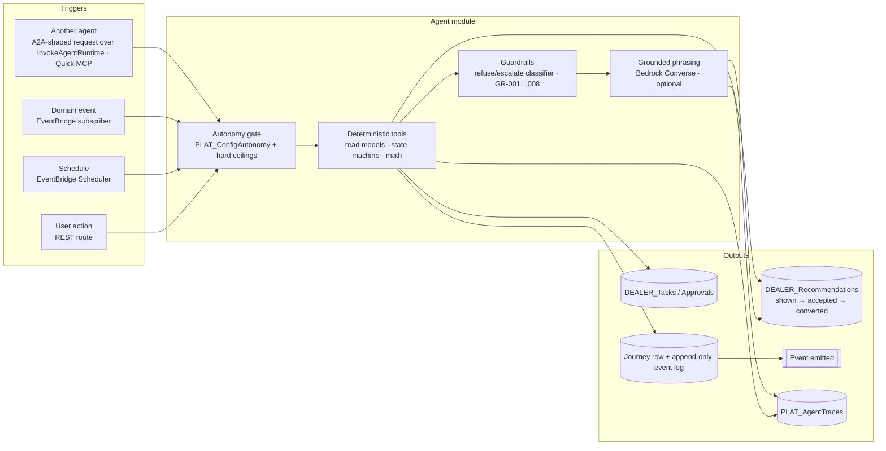
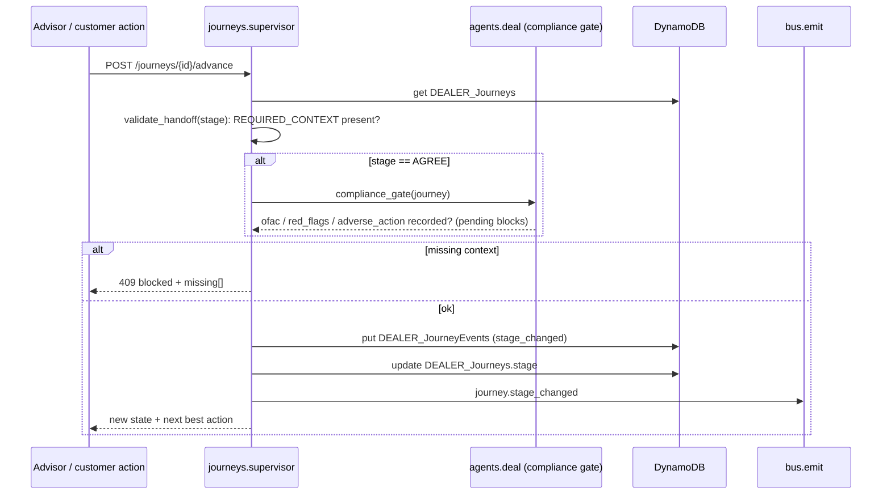
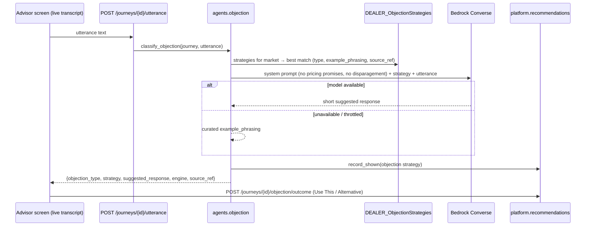
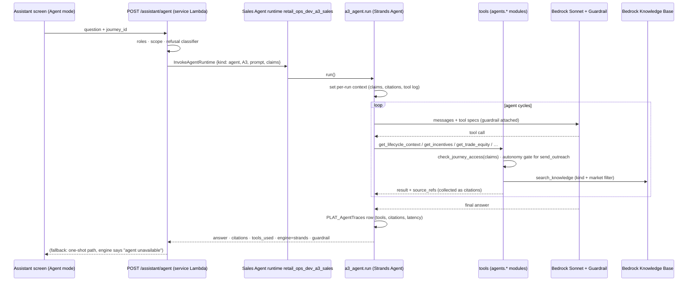
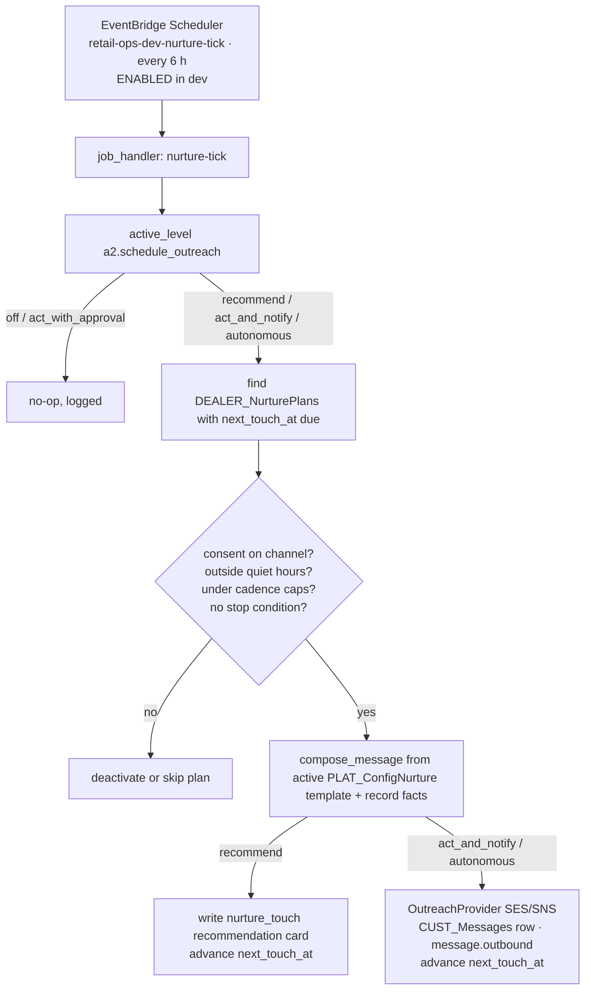
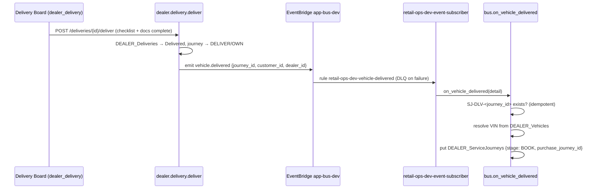
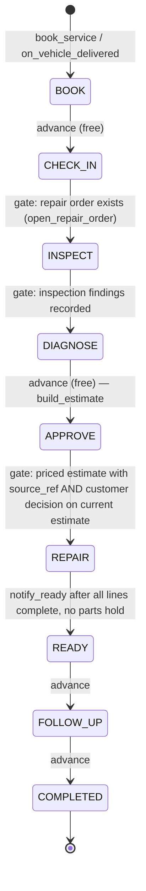
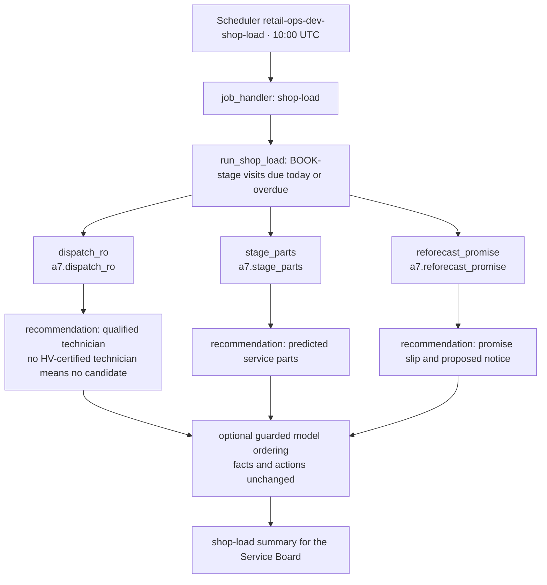
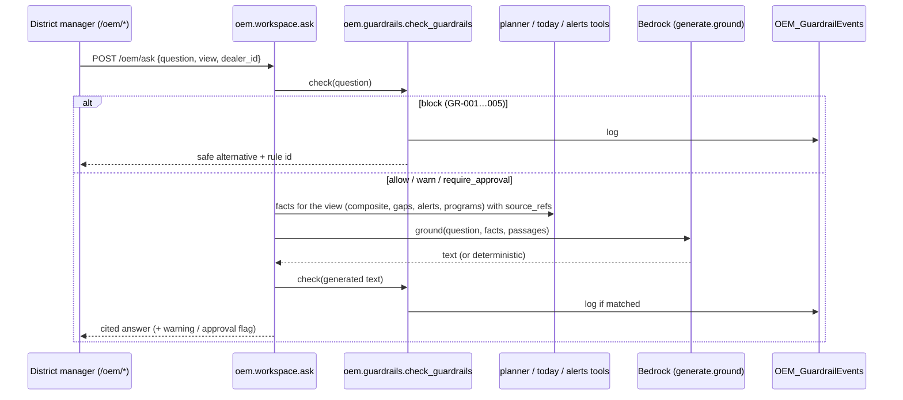
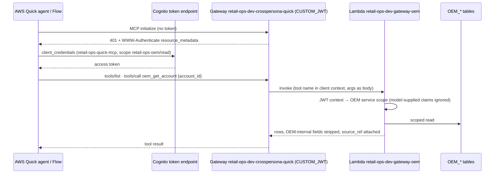

# Automotive Retail Operations powered by Agentic AI — Agent Flows (as built)

**What this document is.** How the agents in `app/services` actually run:
what triggers them, which steps execute in which order, where a decision is
made by code, where a human decides, and where a language model is consulted.
Every flow below is traced to the module that implements it. Target requirements
remain in `docs/specs/retail-ops-architecture.md` §5–§7; current verification status
and environment-dependent boundaries are maintained in `docs/ACCEPTANCE.md`.

---

## 1. The agent model in this build

*Text fallback:* an agent module is entered from a click, a schedule, an event
or another agent (an A2A-shaped request to its AgentCore runtime, or Quick
through the MCP Gateway); it first resolves the autonomy level for its action,
runs deterministic tools (reads, state-machine checks, arithmetic), passes any
text through guardrails, optionally asks Bedrock to phrase an answer over the
facts it collected, and writes its result as a recommendation card, a task or
approval, or a state change with its event — always with a trace row.

Four properties hold everywhere:

1. **Code decides, the model phrases — and, in the A3 pilot, plans.** Ranking,
   gating, pricing, equity, attribution and routing are deterministic and
   testable. Bedrock is called to turn already-retrieved facts into prose (with
   a grounding-only system prompt and a deterministic fallback) and, for the A3
   Assistant, to choose and sequence the tools (§2.4a). Every model call carries
   the managed Bedrock Guardrail; a grounding-only intervention returns the
   context text, a denied-topic intervention returns the blocked message.
2. **Event before state.** `advance_journey` and `advance_service_journey`
   append to `DEALER_JourneyEvents` / `DEALER_ServiceJourneyEvents` first, then
   flip the row, then `bus.emit()` a catalogued type.
3. **Autonomy is configuration, with ceilings.** Each effectful action has an
   id (`a2.schedule_outreach`, `a4.detect_equity`, `a7.dispatch_ro`, …) whose
   active level comes from `PLAT_ConfigAutonomy`. At `recommend` (the shipped
   default) the agent writes a card for a human; at `act_and_notify` or
   `autonomous` it executes. Nine actions have hard ceilings that no
   configuration can raise (budget shifts and plan publishing stop at
   `act_with_approval`; incentive allocation and estimate approval stop at
   `recommend`).
4. **Every figure is sourced.** Tool outputs carry `source_ref`; the
   recommendation loop records whether a human used the output.
5. **Memory is durable but never required for correctness.** `platform/memory.py`
   writes preferences, objections, promises, and facts to the sourced
   `PLAT_AgentMemory` store and, in AWS mode, to AgentCore Memory. A3 answers,
   Sales Packages, and A2 nurture recall that context; an AgentCore failure
   degrades to DynamoDB without blocking the flow.

---

## 2. Process 1 — purchase journey (A2 supervisor with A1 / A3 / A4)

### 2.1 Advancing a journey

*Text fallback:* `advance_journey` loads the journey, checks the stage's
required context (shortlist, saved build, budget and timeline, finance offer,
valuation, deal structure plus recorded compliance, delivered), consults A3's
compliance gate at `AGREE`, and only then writes the event, flips the stage and
emits `journey.stage_changed`. A blocked move returns the missing items.

`select_next_best_action` then names the next agent and action from a per-stage
table (`DISCOVER → A1 recommend_vehicle`, `CONFIGURE → A1 save_build`,
`QUALIFY → A3 book_test_drive`, `FINANCE → A2 present_offer`, `TRADE_IN → A4
compute_equity`, `AGREE → A3 structure_deal`, `DELIVER → A2
schedule_delivery`); `log_nba` records it as a recommendation card.

### 2.2 Sales Package (the supervisor calling its specialists)

`POST /journeys/{id}/package` checks the caller's journey scope, then asks the
Journey Agent runtime (A2) to run `journeys.package.build_sales_package`
(ADR 0009):

1. A1 `rank_vehicles` → `discovery.rank_vehicles` (ranked trims with score
   components and VIN availability).
2. A3 `build_assist` → `suggestions.generate_contextual_suggestions` and
   `intel.get_incentives`.
3. A4 `build_equity` → `equity.build_equity` (equity, payment delta, upgrade
   signal).
4. next-best-action and finance → latest `DEALER_FinanceOffers` for the journey.
5. Each call fails independently into an error card; the result is persisted to
   `DEALER_SalesPackages` and served by `GET /journeys/{id}/package` and the
   Advisor `assist` read model.

Inside the A2 runtime, steps 1–3 are A2A-shaped requests (`kind: tool`, the
caller's claims, the request's `correlation_id`) to the A1, A3 and A4 runtimes
over `InvokeAgentRuntime`, run in parallel with the next-best-action step, each
with an 8 s budget. A specialist that does not answer in time becomes an error
card and is not re-run locally; a specialist whose runtime could not be reached
runs in-process. The package records an `agent_transport` per specialist.

If the A2 runtime itself does not answer in time, the route returns `202
{status: "building", journey_id, poll, requested_at, correlation_id}`: the build
may still finish. `GET /journeys/{id}/package` (the poll target) returns the
persisted package header only, and a fresh build has `generated_at >=
requested_at`; an older header means the build is not done yet. With no A2
runtime configured, or with A2 disabled, the whole package is built in-process in
the service Lambda, sequentially, exactly as before.

### 2.3 Live floor objection (A3)

*Text fallback:* the utterance is matched against the market's strategy library
(the source of truth for what strategies exist), Bedrock phrases a short
response anchored to the matched strategy's example and citation, the curated
phrasing is used if the model is unavailable, the suggestion is recorded as
shown, and the advisor's choice is recorded as an outcome.

### 2.4 Assistant chat and flows (A3)

`POST /assistant/chat` → `assistant.assistant_chat`:

1. **Guardrail first**: `qa.classify_refusal` — credit, legal and approval
   questions return a handoff note without any retrieval or model call.
2. **Facts**: lifecycle context (stage, days in stage, missing handoff items,
   next appointment) and the top two contextual suggestions, each with its
   evidence record as a citation.
3. **Passages**: `platform.knowledge.retrieve(question, k=3)` over the
   corpus (Bedrock Knowledge Base in AWS mode, keyword index offline), each with
   `source_ref`.
4. **Phrasing**: `platform.generate.ground(question, facts, passages)` →
   Bedrock, or the deterministic concatenation of the same facts.
5. Response carries `answer`, `citations[]`, `engine`, `retrieval`.

`POST /assistant/flows/{follow-up-draft | service-upsell | call-list}` run
`draft_follow_up` (template + record facts, never sent), `service_upsell_brief`
(service journey + A4 equity flag) and `build_call_list` (prioritised journeys
with reasons); `POST /assistant/shift-list/publish` turns the call list into
`DEALER_Tasks`.

### 2.4a Assistant reasoning agent (A3, Strands on Bedrock — ADR 0002)

*Text fallback:* the service Lambda checks role, scope and the refusal
classifier, then asks the Sales Agent's own AgentCore runtime to run the Strands agent, which
loops between the model (with the guardrail attached) and the deterministic
tools until it has an answer; every tool re-checks scope, `send_outreach`
honours the autonomy level, every `source_ref` becomes a citation, and a trace
row records what ran. If the runtime or model is unavailable the one-shot path
answers and says so. Evidence: `app/eval/reports/agent-baseline.json` (15/15
golden cases; 6–18 s; judge groundedness 4.0/5).

### 2.5 Nurture tick (A2, scheduled)

*Text fallback:* on each tick the job reads the autonomy level for
`a2.schedule_outreach`; if it may write, it finds due nurture plans, re-checks
consent, quiet hours, cadence caps and stop conditions (`opt_out`, `converted`,
`stage_AGREE_reached`), renders the stage template with facts from the record,
and either writes a recommendation card (default) or actually sends through
SES/SNS and records the message. When the Journey Agent runtime is configured
the job Lambda hands the tick to it (`kind: job`) and the runtime sends through
the same SES/SNS provider under the shared execution role; otherwise the job
runs in the Lambda.

### 2.6 Plays and intent shifts (A2, event- and signal-driven)

* `bus.py` subscribers map triggers to Plays: `journey.stalled → Callback
  Brief`, `discovery.match_found → Recommend Vehicle`, `service.handoff_to_sales
  → Full Prep`, `lease.end_window_entered` and `equity.crossed_positive →
  Upgrade Pitch`. Since 2026-10-08 every trigger has an emitter: the **stall
  sweep** (`journeys/stall_sweep.py`, daily 05:30 UTC) flags active journeys idle
  past `RETAIL_OPS_STALL_SLA_DAYS` (7) once per stall and emits `journey.stalled`; the
  **A1 re-score** (`agents/rescore.py`, daily 05:45 UTC) re-ranks shopping
  journeys and emits `discovery.match_found` when the top trim is in stock at
  the home dealer (idempotent per trim); the equity monitor emits the two
  equity/lease events (§2.8). `plays._TRIGGER_MAP` matches the seed's play tags
  (`idle_days>7`, `positive_equity`); the packs still carry no "Recommend
  Vehicle" or "Full Prep" play, so those two subscribers run and find no play. `plays.run_play` executes the seeded steps at the play's
  autonomy level, writing `DEALER_PlayRuns` and a recommendation card; it never
  messages the customer at `recommend`. (`POST /journeys/{id}/run-play` runs
  one on demand.)
* `intent_shift.detect_intent_shift` reads recent events, messages and
  `DEALER_Signals` and flags budget change, new competitor, gone cold or ready
  to buy, each citing the signal and timestamp; `create_task` opens a dealer
  task so a human sees it. Exposed at `GET /journeys/{id}/intent-shift`.

### 2.7 Customer-facing Q&A (A2)

`POST /shop/chat` or `POST /journeys/{id}/chat` → `qa.answer_customer_question`:
deterministic classifier first (legal, credit decision, safety recall → refuse
or escalate with `escalate_to_human`), then grounding in the customer's own
saved build, finance offer (payment ranges only, never a decision), trade
valuation, active incentives and dealer hours, then Bedrock phrasing with the
same fallback. The reply carries `citations[]` and `suggested_actions`
(`book_test_drive`, `view_build`, `start_prequal`, `get_trade_estimate`).

### 2.8 Nightly equity monitor (A4, scheduled, ENABLED)

`retail-ops-dev-equity-monitor-nightly` (06:00 UTC) → `equity_monitor.run_equity_monitor`:
resolve `a4.detect_equity`; scan active journeys; `equity.build_equity` per
journey; for customers crossing into positive equity upsert a deterministic
`REC-MON-<journey_id>` recommendation card (`equity_flag`) so repeated runs do
not pile up, and emit `equity.crossed_positive` the first time the card is
created; for leases inside the upgrade window write `REC-LEASE-<journey_id>`
once and emit `lease.end_window_entered`. The cards are what the Advisor "Value
Snapshot" and the Service Lane surface; the events fire the Upgrade Pitch play.
Nothing is sent to a customer. The job runs in the Trade-In Agent runtime when
one is configured, and makes no model call: jobs always run in local mode, and
the equity explanation is templated outside AWS mode.

### 2.9 Delivery → first service journey (the process crossing)

*Text fallback:* marking a delivery complete emits `vehicle.delivered`; the
EventBridge rule hands it to the subscriber Lambda, whose `on_vehicle_delivered`
idempotently creates the first service journey in `BOOK`, linked back to the
purchase journey. Locally the same subscriber runs in-process.

---

## 3. Process 2 — service journey (A7 supervisor)

### 3.1 Booking to approval

*Text fallback:* the service journey moves `BOOK → CHECK_IN → INSPECT →
DIAGNOSE → APPROVE → REPAIR → READY → FOLLOW_UP → COMPLETED`; the gates in
`service.supervisor.validate_service_handoff` require a repair order to leave
`CHECK_IN`, recorded findings to leave `INSPECT`, and a priced, sourced estimate
with a recorded customer decision to leave `APPROVE`.

Step by step (`service/*`):

1. **Book** — `booking.predict_next_service(vin)` (odometer + delivery date +
   market distance default + interval, inputs returned) and
   `book_service(vin, services, wait_type)` → `DEALER_ServiceJourneys` +
   `DEALER_Appointments`, `service.journey.created`,
   `service.appointment.booked`. Customers book from My Garage.
2. **Check in** — `connectors.open_repair_order` creates the
   `DEALER_RepairOrders` mirror (`ro.opened`).
3. **Inspect** — technician submits MPI findings against a
   `DEALER_InspectionTemplates` template (ICE / EV / Express);
   `inspection.record_inspection` writes `DEALER_Inspections`
   (`inspection.submitted`); `prioritize_findings` orders red/yellow first.
4. **Estimate** — `inspection.build_estimate` / `estimates.build_lines`: one
   line per red/yellow finding with `finding_ref`, labor op (flat-rate hours ×
   shop rate from `DEALER_LaborOps`), parts (`DEALER_Parts`), coverage
   (`DEALER_Coverage`) and a price `source_ref`; `repair_vs_replace` adds a card
   when the total passes a share of the A4 vehicle value. `desk.diagnose`
   attaches DTC and TSB citations and the procedure per labor op.
5. **Present** — `connectors.present_estimate` marks the estimate presented,
   mints a purpose-bound magic link, emits `estimate.presented`; the customer
   gets SMS/e-mail through `OutreachProvider`.
6. **Decide** — `estimates.decide_lines` per line (customer in My Garage via
   `POST /garage/service/estimates/{id}/decisions`, or advisor on the
   customer's behalf); `estimate.line_decided`; declined lines →
   `DEALER_DeclinedWork` (`service.declined_work.recorded`) and
   `followup.schedule_declined_followup` opens a **service-family** nurture plan
   (30/60/90-day reminders that re-present the original finding; no sales
   content).
7. **Repair** — `repair.track_parts` (a back-order sets `parts_hold`),
   `update_line_status` (`in_progress → complete → qc_passed`).
8. **Ready** — `repair.notify_ready` closes the RO, schedules pickup, notifies
   the customer, advances to `READY` (`vehicle.ready`, `ro.closed`).

### 3.2 Morning shop-load (A7, scheduled)

*Text fallback:* the scheduled job scans BOOK-stage service journeys due today
or overdue and calls three autonomy-gated tools per journey: technician-dispatch
recommendation, predicted-parts recommendation, and promise-slip recommendation.
At configured write levels these produce `DEALER_Recommendations` rows; the job
does not currently assign technicians, order parts, send the customer notice,
call `auto_present_estimate`, or call `prepare_ro_brief`. A guarded model may
reorder the resulting summary cards but cannot add, remove, or change an action.
When the Service Agent runtime is configured the job runs there (`kind: job`,
with the optional `dealer_id`); otherwise in the job Lambda.
The complete target flow is `docs/specs/retail-ops-architecture.md` §6a.

### 3.2a Hourly service follow-up tick (A7, scheduled)

`retail-ops-dev-service-followup-tick` (every hour) → `followup_tick.run_service_followup_tick`,
gated on `a7.send_due_service_reminder`:

1. **Declined-work reminders** — service-family `DEALER_NurturePlans` written by
   `schedule_declined_followup` whose `next_touch_at` is due: stop if the
   customer opted out, booked the work (an open service journey for the VIN
   other than the plan's own), or converted; otherwise pick a consented channel
   (quiet hours and caps re-checked), render the declined-reminder template, and
   at `recommend` write a `REC-DECLINED-<sj>` card (at execute levels send
   through `OutreachProvider`); the plan's cadence advances either way.
2. **Due-service reminders** — delivered vehicles whose `predict_next_service`
   is overdue or due within `RETAIL_OPS_DUE_SERVICE_DAYS` (14) and have no open
   service journey get one `REC-DUE-<vin>` card (`service_due`), the owner's
   nudge in My Garage.

The tick runs in the Service Agent runtime when one is configured and still
sends through SES/SNS there (the shared execution role has the `Outreach`
statement); it reuses the Journey Agent's consent check and message
composition as shared code, not as a call to the A2 runtime.

### 3.3 Service → sale (A7 → A2)

1. `lane_monitor.run_service_lane_monitor` (07:00 UTC schedule) scans `FOLLOW_UP` service journeys, computes equity with A4 and
   writes a `service_handoff` recommendation card for customers crossing into
   positive equity (gated on `a2.select_next_best_action`, since the card enters
   the sales funnel).
2. An advisor actions it: `POST /service/{id}/handoff-to-sales` →
   `supervisor.handoff_to_sales` creates a new purchase journey in `DISCOVER`
   owned by A2 and emits `service.handoff_to_sales`.
3. The bus subscriber runs the **Full Prep** play; the Service Lane screen
   (`GET /service/lane`) shows the equity flag and an A3 upsell brief.

### 3.4 Predictive maintenance (A7)

`predictive.py` applies per-part wear curves to odometer and service history
and raises `DEALER_Leads` rows (`source=predictive_maintenance`,
`lead.predictive_raised`) that the Lead Desk works inside its SLA, plus an
offer on My Garage. The odometer is the only "telematics" signal; the module
documents itself as the seam for a live telematics connector.

---

## 4. OEM level — A6 and A5

### 4.1 Guardrail-checked ask (A6)

*Text fallback:* the question is checked against GR-001…GR-008 before anything
else; blocked topics (wholesale cuts, termination language, specific pricing,
hiring/firing, allocation promises) return a safe alternative and are logged;
otherwise the deterministic planner tools gather sourced facts, Bedrock phrases
the answer, and the output is checked again before it is returned.

### 4.2 Account plan with human approval (A6)

1. `account_plan.draft_account_plan(account_id)` — objectives tied to concrete
   metric gaps (health indices, days supply, open alerts, active C&I
   programs); writes `OEM_AccountPlans` with `status=draft`,
   `publish_level=recommend`.
2. `POST /approvals/plan/{id}/submit` → `plan_approval.submit_plan` marks it
   `pending_approval` and starts the Step Functions execution
   `retail-ops-dev-plan-approval`; the first state invokes
   `retail-ops-dev-approvals-submit` with `waitForTaskToken`, which stores the token
   on the plan and leaves the execution paused.
3. A human with the approver role calls `POST /approvals/plan/{id}/decide`;
   `decide_plan` sends `SendTaskSuccess` / `SendTaskFailure`, the execution
   ends in `Approved` or `Rejected`, and the plan status flips
   (`plan.published` on approval). Without the state machine ARN (local dev)
   the status transitions are still recorded, so the flow is testable offline.
4. `district_cycle.run_district_cycle` (job, not yet scheduled) drafts plans
   for every red dealer in a district; it never publishes.

### 4.3 Campaign attribution and budget shift (A5)

* Read path: `marketing.analytics.campaign_overview` → spend per campaign
  allocated to dealers, journeys reaching each stage by source, campaign-tagged
  journeys that reached delivery, cost per delivery and ROI;
  `oem.campaigns.build_campaign_roi` adds a Bedrock insight sentence over the
  computed figures.
* Write path: `submit_budget_shift` → recommendation card +
  `DEALER_Approvals` request (`approval.requested`) for `oem_finance`.
  `campaigns.run_nightly_attribution` (the `nightly-attribution` job) drafts the
  request when a shift's projected lift exceeds a configurable threshold
  (default 5,000 in market currency).
  Approval records a decision; no code path changes spend (hard ceiling).
* Where it runs: the Campaign Agent runtime serves the nightly job and both
  POSTs (`POST /oem/campaigns/budget-shift` and `POST
  /marketing/campaigns/budget-shift/submit`) when configured; the dashboards stay
  in AWS Quick. A submit whose runtime call was sent but not answered is not
  re-run, so the approval may already exist and a retried submit answers 409.
  `approval.requested` can therefore be emitted more than once for one
  `approval_id`: consumers treat it as at-least-once.
* Audiences: `audiences.build_audiences` (rule segments) and `export_audience`
  (hashed ids only, consent opt-outs refused, `audience.exported`).

---

## 5. External agents calling in

### 5.1 AgentCore runtimes (one per agent)

Each custom agent has its own runtime (ADR 0009): `retail_ops_dev_a1_discovery`,
`retail_ops_dev_a2_journey`, `retail_ops_dev_a3_sales`,
`retail_ops_dev_a4_trade_in`, `retail_ops_dev_a5_campaign` and
`retail_ops_dev_a7_service`. Each serves the AgentCore HTTP contract (`GET
/ping`, `POST /invocations`) for its own agent only (`RETAIL_OPS_AGENT_ID`), with
three payload kinds defined in `app/agentcore/registry.py`:

* **tool** `{kind: "tool", agent, tool, args, claims, correlation_id, caller}`
  runs one of that agent's registered tools after validating the arguments and
  claims and checking role and journey scope;
* **agent** `{kind: "agent", agent: "A3", prompt, journey_id, claims}` runs
  `a3_agent.run` (only the Sales Agent bundle vendors `strands-agents` and gets
  the Knowledge Base id);
* **job** `{kind: "job", agent, job, payload, apply}` runs one of that agent's
  scheduled jobs in local mode (no model calls).

Every answer is one envelope `{statusCode, result, agent, runtime, transport,
version}`, and the rows the
runtime writes to `PLAT_AgentTraces` carry `transport: agentcore-runtime`. A
deployed runtime refuses the old generic router payload (`{method, path, …}`).
The service Lambda uses `agent` for `POST /assistant/agent` and `tool` for the
Sales Package (A2) and the two A5 POSTs; the job Lambdas use `job`.

### 5.2 AWS Quick via the MCP Gateway

*Text fallback:* Quick's MCP connector authenticates to the CUSTOM_JWT Gateway
with a Cognito client-credentials token; the Gateway invokes the OEM-read
Lambda, which derives a service-level OEM scope from the token (ignoring any
claims the model might pass), reads the OEM tables, strips internal fields and
returns cited rows for the four tools `oem_list_accounts`, `oem_get_account`,
`oem_get_alerts`, `oem_get_incentive_programs` (alerts with title, category, status and
dates; programs with start/end dates, window, goal and status; every record with
`source_ref` and the row's `data_source_ref`). The console path uses the
sibling AWS_IAM Gateway through `GET /gateway/oem/{tool}`.

---

## 6. Trigger inventory

| Trigger | Mechanism | Agent flow | State today (dev) |
|---|---|---|---|
| Nightly 06:00 UTC | Scheduler `retail-ops-dev-equity-monitor-nightly` → `equity-monitor` (→ Trade-In Agent runtime) | §2.8 | ENABLED |
| Every 6 h | Scheduler `retail-ops-dev-nurture-tick` → `nurture-tick` (→ Journey Agent runtime) | §2.5 | ENABLED (level `recommend`: cards, no sends) |
| Daily 05:30 UTC | Scheduler `retail-ops-dev-stall-sweep` → `stall-sweep` (→ Journey Agent runtime) | §2.6 | ENABLED |
| Daily 05:45 UTC | Scheduler `retail-ops-dev-rescore-profiles` → `rescore-profiles` (→ Discovery Agent runtime) | §2.6 | ENABLED |
| Nightly 07:00 UTC | Scheduler `retail-ops-dev-service-lane-monitor` → `service-lane-monitor` (→ Service Agent runtime) | §3.3 | ENABLED |
| Daily 10:00 UTC | Scheduler `retail-ops-dev-shop-load` → `shop-load` (→ Service Agent runtime) | §3.2 | ENABLED |
| Hourly | Scheduler `retail-ops-dev-service-followup-tick` → `service-followup-tick` (→ Service Agent runtime) | §3.2a | ENABLED |
| Nightly 08:00 UTC | Scheduler `retail-ops-dev-nightly-attribution` → `nightly-attribution` (→ Campaign Agent runtime) | §4.3 | ENABLED |
| Weekly Mon 05:00 UTC | Scheduler `retail-ops-dev-district-cycle` → `district-cycle` | §4.2 | ENABLED |
| `vehicle.delivered` | rule → subscriber Lambda | §2.9 | live |
| `journey.stalled`, `discovery.match_found`, `lease.end_window_entered`, `equity.crossed_positive`, `service.handoff_to_sales` | subscriber → Plays | §2.6 | live, all five emitted; the packs lack "Recommend Vehicle" / "Full Prep" plays, so `discovery.match_found` and `service.handoff_to_sales` currently find no play |
| `appointment.booked`, `deal.booked`, `estimate.line_decided`, `service.appointment.booked` | subscriber → recommendation conversion joiner / cockpit cache invalidation | §1 outcome loop | live |
| Any route | REST (the service Lambda) | all | live |
| `POST /assistant/agent` | service → `InvokeAgentRuntime` → Sales Agent runtime → Strands agent | §2.4a | live (15/15 golden cases) |
| `POST /journeys/{id}/package` | service → Journey Agent runtime → A2A-shaped requests to the A1, A3 and A4 runtimes | §2.2 | code merged; in-process until the runtimes are created |
| `POST /oem/campaigns/budget-shift`, `POST /marketing/campaigns/budget-shift/submit` | service → Campaign Agent runtime (`kind: tool`) | §4.3 | code merged; in-process until the runtimes are created |
| MCP tool call | Quick → Gateway → Lambda | §5.2 | live (Quick-side content pending) |

Every job the agent bar shows as "Scheduled" ships ENABLED from `deploy_l6.py`
for both markets (user decision 2026-10-22; only `autonomy-promotion` ships
DISABLED) and runs at autonomy level `recommend`, so every job writes cards and
events but never messages a customer. `--disable-writers` quiets them until the
next deploy. `store-digest` is the one job that calls Bedrock (in its own
Lambda). The
"(→ … runtime)" notes apply once the runtimes are created and wired (ADR 0009);
until then, and whenever an agent is disabled, every job runs in its Lambda.
