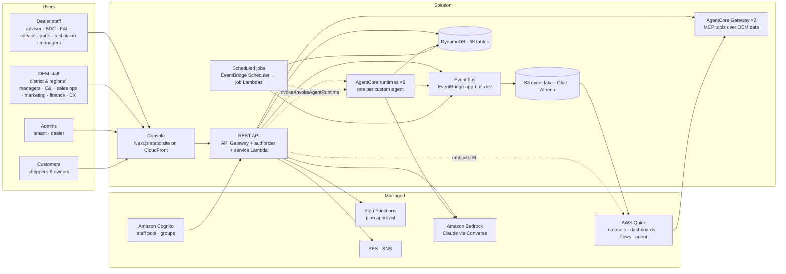
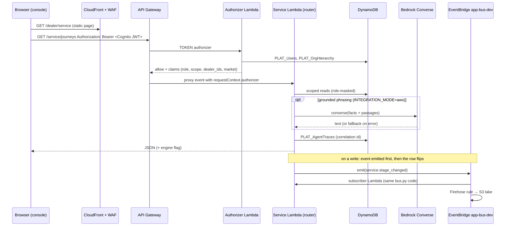
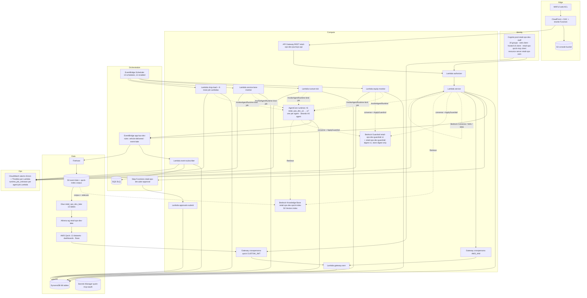

# Automotive Retail Operations powered by Agentic AI — Architecture (as built)

**What this document is.** A bottom-up description of the reference
implementation in `app/`, derived from the code and the deployers, and
reconciled against the development account (last reconciled 2026-10-13). It
tells an external reader what the system is, how it is put together, and how
it is deployed. It describes the current implementation and nothing else:
target requirements stay in `docs/specs/intelligent-sales-service-orchestration.md`
(diagrams in `docs/specs/retail-ops-architecture.md`), run and deploy instructions in
`docs/DEPLOYMENT.md` and `docs/DEMO.md`, the live resource inventory in
`docs/DEMO.md`, and verification status with environment-dependent boundaries
in `docs/ACCEPTANCE.md`. Those facts are deliberately not repeated here.

**Audience.** Architects and engineers evaluating the solution, partners who
want to deploy it in their own account, and reviewers who need to know what is
real versus what is a documented swap point.

> Naming note. The repository, tables, Lambdas and roles use the technical
> namespace `retail-ops` / `retail-ops-dev-` (an internal abbreviation of the product name).
> It is a resource prefix, not a product brand.

---

## 1. One-paragraph summary

The solution is a **serverless, event-driven application on AWS** that runs two
business processes for an automotive OEM and its dealers — the **purchase
journey** (lead → delivery) and the **service journey** (booking → follow-up) —
and the staff and customer screens around them. All business logic lives in one
Python package (`app/services`, 152 modules) that is exposed three ways: as a
**REST API** (API Gateway + one Lambda router), as **one Amazon Bedrock
AgentCore runtime per custom agent** (six runtimes, A1, A2, A3, A4, A5's
recommendation step and A7, each serving only its own agent's tools and jobs
behind the AgentCore `/invocations` contract; the old generic router transport
is retired, [ADR 0009](../adr/0009-one-runtime-per-agent.md)), and as
**scheduled jobs** (EventBridge Scheduler, delegated to the owner agent's
runtime when one is configured). The "agents" A1–A7 are
deterministic, tested Python tool modules; a **Strands reasoning agent** plans
over those tools for the Dealer Sales Advisor assistant (ADR 0002),
and Amazon Bedrock (Claude, via the Converse API) phrases grounded answers at a
handful of well-defined points. Every model call carries a managed **Bedrock
Guardrail**, retrieval runs on a **Bedrock Knowledge Base** over the corpus,
and every generative path has a deterministic fallback. State is 68 DynamoDB
tables (the spec's 67 plus `OEM_CatalogModels` and `PLAT_Config`, which the spec
does not list yet), changes are
published as typed events on an EventBridge bus, events land in an S3 lake for
analytics in AWS Quick, and a Next.js console (one static site, five "apps"
in one shell) is served from CloudFront behind Cognito sign-in.

---

## 2. System context



*Text fallback:* dealer, OEM, admin and customer users open one console on
CloudFront, which calls one REST API. The API and the scheduled jobs call the
six AgentCore runtimes (one per custom agent) for agent work and run the same
code in-process when no runtime is configured. All three, which share one code
base, read and write DynamoDB, publish events to
EventBridge, call Bedrock for grounded phrasing, and drive the Step Functions
approval and SES/SNS outreach. Events flow through Firehose into an S3 lake
queried by Athena and AWS Quick. Quick reaches operational OEM data only
through an AgentCore Gateway. Cognito authenticates staff.

### Personas served

The persona matrix is code (`app/services/common/personas.py`) and is read by
the console through `GET /me/home` and `GET /nav/resolve`. There are **19 staff
roles** (the Cognito groups), the **Administrator** (`platform_admin`, SSO
allowlist only), and `customer`:

| Group | Roles (Cognito groups) | Home screen |
|---|---|---|
| Dealer sales | `dealer_advisor`, `dealer_bdc`, `dealer_fni`, `dealer_inventory`, `dealer_delivery`, `dealer_manager` | Journeys · Lead Desk · F&I Desk · Inventory & Trade Desk · Delivery Board · Store Cockpit |
| Dealer service | `dealer_service`, `dealer_technician`, `dealer_parts`, `dealer_service_manager` | Service Board · My ROs · Parts Desk · Service Cockpit |
| OEM | `oem_dm`, `oem_regional`, `oem_ci_planning`, `oem_sales_ops`, `oem_finance`, `oem_marketing`, `oem_cx` | OEM Today · Region · Accounts · Comms · Campaigns · Journey Ops |
| Admin | `admin_tenant`, `admin_dealer` | Admin Console |
| Administrator | `platform_admin` (not a Cognito group; `PLAT_Users` rows written by the `sso-admins` stage for the aliases in `RETAIL_OPS_SSO_ADMINS`) | Admin Console; every staff screen of every app, tenant-wide; no customer screen |
| Customer | `customer` (magic link or dev token) | My Garage |

---

## 3. Logical layers (what the code is made of)

The package is organised by **who owns the data**, not by agent. Every DynamoDB
table carries an owner prefix (`OEM_`, `DEALER_`, `CUST_`, `PLAT_`), and
`app/services/common/crosspersona.py` refuses a direct read across owners from a
caller of another persona (OEM may read down; dealers reach OEM data only via
the Gateway tools).

```
app/
  agentcore/agent.py        AgentCore runtime HTTP contract (/ping, /invocations) → dispatch by kind tool | agent | job
  agentcore/registry.py     the six agents: tools, jobs, reasoning entry, payload/claims validation, runtime names
  agentcore/client.py       service side: RETAIL_OPS_AGENT_RUNTIMES → InvokeAgentRuntime, in-process fallback
  agentcore/bundle.py       per-agent import closure → reproducible arm64 zip + BUILD_INFO.json
  agentcore/tools/          thin per-agent adapters (a1 … a7) over the service functions
  services/
    api/                    authorizer, handler (router), platform_routes, routes/* (7 domain route tables)
    common/                 ddb, authz (role + org-scope), personas, market, autonomy_config,
                            crosspersona, resource_url, trace, jwt_verify, local_ddb (offline stand-in)
    agents/                 A1 discovery/configurator/tco · A3 assistant/suggestions/objection/intel/deal
                            · A4 trade/equity/equity_monitor/prospects
    journeys/               A2: supervisor (state machine), package, nurture, nurture_tick, plays, qa,
                            intent_shift, actions, handoffs, board, assist
    service/                A7: supervisor, booking, inspection, estimates, repair, followup, morning_work,
                            shop_load, lane_monitor, predictive, connectors, desk, board
    oem/                    A6: workspace, today, alerts, account_plan, planner, guardrails, district_cycle
                            · A5: campaigns
    marketing/              A5: analytics, audiences · Journey Ops config editor
    dealer/                 read models + writes: cockpit, fni, inventory, leads, delivery, documents, notifications
    customer/               My Garage portal, service portal, shop (customer discovery + chat), magic links
    admin/                  config_store (versioned PLAT_Config*), autonomy, directory, connectors,
                            data_requests, entities, audit_log, harness, agents_health
    approvals/              generic inbox (DEALER_Approvals) + Step Functions plan approval
    events/                 bus (80-type catalogue, emit, subscribers) + subscriber Lambda
    gateway/                Gateway Lambda target + 4 OEM read tools + runtime-side client
    platform/               swap-point interfaces: generate (Bedrock), knowledge, ranker, compute,
                            outreach (SES/SNS), quick (quicksight), tasks, recommendations
    l1_data/ddb_load.py     synthetic data → DynamoDB tables
  infra/                    18 boto3 deployers (one per stage) + iam_roles.py (per-function roles)
  console/                  Next.js 15 app (76 pages), static export
  demo/run_demo.py          end-to-end write loop + smoke + acceptance checks against the live API
```

### 3.1 Access layer

* **Authorizer** (`api/authorizer.py`, Lambda `retail-ops-dev-journeys-authorizer`,
  API Gateway TOKEN authorizer). Accepts a Cognito RS256 JWT from the
  `retail-ops-dev-staff` pool (verified with PyJWT when the optional `retail-ops-dev-jwt`
  layer is present, else a stdlib RSA verify), a customer magic-link session
  (`mlk:` prefix, HS256 signed by the app), or — when `RETAIL_OPS_ALLOW_DEV_TOKEN`
  is on — a dev token `user:<id>` / `cust:<id>`. All three resolve through the
  same path: `PLAT_Users` → role, `scope_node_id`, `market_id`,
  `dealer_ids` (the dealer leaves under the user's node in `PLAT_OrgHierarchy`).
  A federated token resolves by its IdP-stripped username, `email`, or
  `preferred_username` → `PLAT_Users.username`, and last by the SSO allowlist
  (`common/sso_allowlist.py`: the alias lower-cased and without `@corp.example.com`,
  looked up as `U-ADMIN-<alias>` and accepted only with the
  `provisioned_by=sso-allowlist` marker and only for a sign-in from the IdP
  recorded on the row, whichever step found it). Anything else is
  `401 unknown user`.
* **Scope enforcement** happens in the service, not just the authorizer:
  every list is filtered to the caller's dealer scope (`routing.scoped_rows`),
  every resource read checks `dealer_in_scope`, customers are self-scoped,
  and admin impersonation (`X-Act-As`) is audited. The Administrator reads every
  module (OEM read-across plus `authz.OEM_VIEW_ROLES` on the OEM and Marketing
  read routes), does what a tenant admin does (`authz.ADMIN_ROLES`,
  `TENANT_ADMIN_ROLES`), performs persona actions only through `X-Act-As`, and
  can never be the `X-Act-As` target.
* **Role masking** is server-side: e.g. a technician never receives customer
  contact data or pricing on a repair order (`service/desk.py`), and My Garage is
  built from explicit field allowlists (`customer/garage.py`).

### 3.2 Service layer (the "brain")

One Lambda, `retail-ops-dev-journeys-service`, runs `api/handler.lambda_handler`.
Routing is in three places, tried in order:

1. `platform_routes.py` — tasks, handoffs, activity feed, resource-URL
   resolver, persona home, recommendation outcome loop, agent action registry.
2. `routes/*.py` — seven table-driven modules: `sales_floor`, `store_ops`,
   `service_desk`, `customer_web`, `marketing_oem`, `admin_console`, `shell`.
3. `handler.py` — the original regex routes (journey assist/board/state/advance,
   OEM today/alerts/plans, service state machine, approvals, Gateway bridge,
   Quick, notifications, garage).

Roughly **300 routes** in total (see `docs/ACCESS_BY_PERSONA.md` for the
persona view). Domain errors map to HTTP codes in each route table; every
request carries an `X-Correlation-Id` that is written to `PLAT_AgentTraces`
(`common/trace.py`) so the console's "AI Log" can show what ran.

### 3.3 Agents

"Agent" here means two layers ([ADR 0002](../adr/0002-tools-plus-reasoning-agent.md)):

* **Tools** — a domain module whose functions are the tools the spec names,
  invoked by the router (on a click), by the scheduler (on a clock), or by an
  event subscriber. Deterministic, tested, every figure sourced.
* **Reasoning agent** — a [Strands](https://strandsagents.com) `Agent` on
  Amazon Bedrock that chooses and sequences those tools. Today one exists: the
  **A3 Assistant** (`agents/a3_agent.py`, eleven tools, `POST /assistant/agent`
  or `/assistant/chat {"mode":"agent"}`). It runs inside the Sales Agent runtime
  `retail_ops_dev_a3_sales`; the service Lambda delegates with `InvokeAgentRuntime`
  (`app/agentcore/client.py`) and falls back to the one-shot path, saying so in
  `engine`. Deterministic fences run *before and around* the model: the A2
  refuse/escalate classifier, per-journey scope, the per-action autonomy level,
  and the Bedrock Guardrail attached to the model.

**Where each agent runs** ([ADR 0009](../adr/0009-one-runtime-per-agent.md)).
Each custom agent has its own AgentCore runtime, named
`retail_ops_<env>_<code>_<slug>`: `retail_ops_dev_a1_discovery`,
`retail_ops_dev_a2_journey`, `retail_ops_dev_a3_sales`,
`retail_ops_dev_a4_trade_in`, `retail_ops_dev_a5_campaign` (the recommendation
step only) and `retail_ops_dev_a7_service`. The Field Sales Agent (A6) stays in
AWS Quick. `app/agentcore/registry.py` lists what each runtime serves; only
agent work is routed there (the A3 agent turn, the Sales Package, the two A5
budget-shift POSTs and the nine agent-owned jobs), and every other route runs in
the service Lambda. With no runtime configured the same function runs
in-process. A3 is the only reasoning agent; the others are deterministic tool
agents until their golden suites justify promotion (ADR 0006). All six runtimes
share one execution role, `AmazonBedrockAgentCore-retail-ops-exec`.

Durable customer memory is implemented by `platform/memory.py`. Every sourced
preference, objection, promise, or fact is retained in `PLAT_AgentMemory`; in
AWS mode with a provisioned AgentCore Memory the same event is also written
there and recall merges both sources. AgentCore failures degrade to the
DynamoDB provenance store without breaking the caller. The agent runtimes are not
given a Memory id or the Memory actions, so inside them memory is
`PLAT_AgentMemory` only. **Not deployed in the development environment:**
`deploy_memory.py` (which creates the `PLAT_AgentMemory` table and the AgentCore
Memory) is not a `deploy.sh` stage, so neither exists there; `remember()` reports
`stored: false` and `recall()` returns nothing, and callers carry on without
memory. Agent behavior also
comes from twelve scheduled jobs, Play subscribers, the A3 tool-planning loop, and
per-action **autonomy levels** stored in `PLAT_ConfigAutonomy`
(`off · recommend · act_with_approval · act_and_notify · autonomous`,
`common/autonomy_config.py`) with hard ceilings the admin editor cannot raise.
The agent flows are described in `agent-flows.md`; the behaviour is measured by
`app/eval/run_eval.py` (golden prompts; offline suite is the CI gate).

**Where the model is used.** Amazon Bedrock (`bedrock-runtime` Converse API,
default model `us.anthropic.claude-opus-4-5-20251101-v1:0`, overridable with
`RETAIL_OPS_BEDROCK_MODEL`) is called in seven places, all of the shape *"here are
facts and passages the tools already retrieved with their `source_ref`s; phrase
an answer, do not add anything"*:

| Call site | What it phrases |
|---|---|
| `platform/generate.ground()` | shared grounded-answer helper used by A2 customer Q&A, A3 assistant chat, A6 workspace `ask`, A7 explain-finding |
| `agents/objection.py` | the suggested response to a live-floor objection (anchored to a strategy row) |
| `agents/discovery.py` | one-line "why this fits" for the top vehicle match |
| `agents/equity.py` | one-line plain-language explanation of the equity numbers |
| `journeys/qa.py` | customer-facing answer, after a deterministic refuse/escalate classifier |
| `oem/campaigns.py` | the budget-shift insight sentence on ROI figures |
| `oem/today.py` | the single AI-insight card on the OEM Today dashboard |

Every call is gated by `INTEGRATION_MODE=aws`, has a deterministic fallback
text, and reports `engine: bedrock | deterministic (...)` in its response so the
UI can be honest. **Every call also attaches the managed Bedrock Guardrail**
`retail-ops-dev-guardrail` (`app/infra/deploy_guardrails.py`; STANDARD tier): six
denied topics (credit decisions, legal interpretation, safety-recall advice,
dealer wholesale/allocation/pricing instructions, dealer termination,
personnel decisions), content filters, a scare-language word list, C4
identifier anonymisation, and a contextual-grounding check. `generate.ground()`
tags the context as the grounding source and the question as a guarded query;
a grounding-only intervention (the model drifted from the context) returns the
deterministic context text, a topic intervention returns the guardrail's
blocked message, and the response carries `guardrail.{applied,intervened,matched}`.
The A6 rule set GR-001…GR-008 stays as a code rules engine (`oem/guardrails.py`)
that names the rule and offers a safe alternative, and logs to
`OEM_GuardrailEvents`. A calibration list (`deploy_guardrails.py --calibrate`,
13 allowed / 8 denied prompts) guards against false positives on every change.
The one exception is the nightly store digest, which carries its own copy,
`retail-ops-dev-guardrail-digest`: the same topics, filters, words and PII
policy, with the grounding check relaxed to 0.2 and no relevance check (user
decision 2026-10-22, ADR 0003 amendment). Only the store-digest Lambda is wired
to it; every other call keeps `retail-ops-dev-guardrail`.

### 3.4 Swap-point interfaces (`app/services/platform/`)

The spec names several managed services. Each is behind a small interface with
a working local implementation and a documented AWS implementation; the mode is
`INTEGRATION_MODE=local|aws`.

| Interface | Local implementation (default, tested) | AWS implementation | Status in code |
|---|---|---|---|
| `generate` | return the caller's deterministic text | Bedrock Converse + Guardrail | **real** (used live) |
| `ranker` | transparent rules ranker with score breakdown | Amazon Personalize `GetPersonalizedRanking` (needs `RETAIL_OPS_PERSONALIZE_CAMPAIGN_ARN`) | real code path, no trained campaign |
| `knowledge` | keyword scan over `PLAT_KnowledgeCollections` + reference tables | Bedrock Knowledge Base `retail-ops-dev-quick-index` (Titan v2 embeddings, S3 Vectors store, 538 docs, `kind`/`market` metadata filters), falling back to the local index and reporting the engine | **real** (used live) |
| `memory` | provenance-preserving `PLAT_AgentMemory` rows | AgentCore Memory events and preference extraction, merged with DynamoDB recall | **real code path, not deployed** — `deploy_memory.py` is not a `deploy.sh` stage, so the development environment has neither the table nor the AgentCore Memory; the DynamoDB rows stay authoritative for source references once deployed |
| `compute` | restricted-AST arithmetic with an audit triple (inputs, code, result) | AgentCore Code Interpreter (`bedrock-agentcore` start/invoke/stop session, `aws.codeinterpreter.v1`, session cached per container, session id in `source_ref`) | **real** — falls back to the audited local twin and labels the engine when the service is unreachable |
| `connectors` | DynamoDB-backed sandbox implementations for DMS, labor, and parts | `LiveConnector` loads endpoint and credential references from configuration | **real interface** — live endpoints are not configured in the reference environment |
| `outreach` | — | SES e-mail + SNS SMS, consent-checked, recorded to `CUST_Messages`; Amazon Connect documented | **real** (SES/SNS) |
| `quick` | `DisabledQuick` when `ENABLE_QUICK=false` | `quicksight` ListFlows / ListDashboards / registered-user embed URL with `AllowedDomains` from `RETAIL_OPS_QUICK_EMBED_DOMAINS` (per-user reader registration only with `RETAIL_OPS_QUICK_PER_USER_EMBED=1`, off by default) | **real** — the `l4` stage sets `ENABLE_QUICK=true` when the account has AWS Quick, and the console URL as the embed domain |

**Streaming boundary.** The live-floor client uses the authenticated
`POST /journeys/{id}/utterance-sse` API route. It returns an SSE document but
API Gateway REST and the managed Python runtime buffer it, so the current build
does not claim progressive token streaming. ADR 0008 prohibits public Lambda
Function URLs; `deploy_streaming.py` is retained only as an `AWS_IAM`-and-OAC
guarded future transport and is not part of the default deployment.

### 3.5 Data layer

* **DynamoDB** — 68 on-demand tables, `retail-ops-dev-<Owner>_<Name>` (39 `DEALER_`,
  14 `OEM_`, 12 `PLAT_`, 3 `CUST_`), created and loaded by
  `l1_data/ddb_load.py` from the committed synthetic packs
  (`sample-data/synthetic/{us,de}`). Key families: journeys and their
  append-only event logs (`DEALER_Journeys`/`DEALER_JourneyEvents`,
  `DEALER_ServiceJourneys`/`DEALER_ServiceJourneyEvents`), the service
  reference set (`DEALER_LaborOps`, `DEALER_Parts`, `DEALER_DTCReference`,
  `DEALER_Coverage`, `DEALER_InspectionTemplates`), OEM account planning
  (`OEM_Accounts`, `OEM_Alerts`, `OEM_AccountPlans`, `OEM_CIPrograms`,
  `OEM_GuardrailEvents`), and the platform set (`PLAT_Users`,
  `PLAT_OrgHierarchy`, `PLAT_Config*` versioned configuration,
  `PLAT_AgentTraces`, `PLAT_AgentMemory`, `PLAT_EntityMap`,
  `PLAT_KnowledgeCollections`). AgentCore Memory is the managed recall layer;
  `PLAT_AgentMemory` retains deterministic source provenance and supports
  offline execution.
* **Versioned configuration** (`admin/config_store.py`) — guardrail rules, the
  A3 suggestion matrix, notification rules, feature flags, the connector
  registry, tenant settings and the A2 nurture policy are append-only
  `PLAT_Config*` rows; publishing a new version changes agent behaviour on the
  next invocation (no redeploy) and emits `config.published`.
* **Offline mode** — `common/local_ddb.py` is an in-memory stand-in seeded from
  the same packs; `RETAIL_OPS_LOCAL_DATA=1 python3 -m app.services.devserver` runs
  every screen without AWS, and the 248 offline tests in `tests/app` use it.
* **S3 event lake** — an EventBridge rule on `app-bus-dev` → Kinesis Firehose →
  `s3://retail-ops-dev-event-lake-<account>/journey-events/dt=YYYY-MM-DD/` → Glue
  database `retail_ops_dev_lake` (13 external tables: `journey_events` plus
  `lake_*` mirrors and derived roll-ups `lake_rdr`, `lake_csi`,
  `lake_marketintel`, `lake_leads`, `lake_campaigns`) →
  Athena workgroup `retail-ops-dev-lake`. The same bucket holds the **knowledge
  corpus** (538 Markdown documents under `quick-index/<kind>/`) exported for
  AWS Quick knowledge bases.
* **Knowledge Base** — `deploy_knowledge_base.py` builds a Bedrock Knowledge
  Base over the same `quick-index/` corpus: an S3 Vectors bucket and index
  (1024-dim cosine), a service role, a data source with fixed-size chunking,
  and one `<doc>.md.metadata.json` sidecar per document carrying `kind`,
  `market` and `collection_id` so `Retrieve` can filter by collection and
  market. Ingestion indexed all 538 documents; `knowledge.retrieve()` parses
  each chunk's `source_ref` line so citations resolve to the original record.
* **Analytics** — `deploy_quick_datasets.py` creates one Athena data source and
  a DIRECT_QUERY Quick dataset per Glue table, and grants `retail-ops-builders` owner
  on them; `deploy_quick_groups.py` creates the five Quick sharing groups
  (`retail-ops-builders`, `retail-ops-oem-*`) and runs first.
  `deploy_quick_content.py` then creates the Quick content through the Quick API:
  two custom-SQL datasets (the journey funnel, and campaign spend allocated over the
  journeys each campaign started), the topic `Retail Ops Journey Funnel`, 9 knowledge
  bases over `quick-index/`, the space, the Field Sales chat agent, 8 Flows and the
  dashboard `Retail Ops Campaign ROI & Funnel`, shared with the groups. The MCP
  connector to the CUSTOM_JWT gateway is built in the Quick console (the API rejects
  the MCP type); a re-run links it to the space and the agent, and the Flows reach the
  OEM reads through that agent.
  With `RETAIL_OPS_QUICK_PER_USER_EMBED=1` (off by default), the embed route registers
  the signed-in user as a Quick reader under their `user_id` and adds them to the
  group for their role (`platform/quick.py` `QUICK_GROUP_BY_ROLE`); the group lets
  them open shared content. With it off, embeds use the shared embed user. Quick content is not row-scoped (row-level security removed by user
  decision on 2026-10-21, spec §13): a reader sees all rows of what they can open.

### 3.6 Event backbone

`events/bus.py` holds a **catalogue of 80 event types** (`journey.*`,
`service.*`, `estimate.*`, `ro.*`, `parts.*`, `trade.*`, `deal.*`, `task.*`,
`handoff.*`, `approval.*`, `alert.*`, `plan.*`, `recommendation.*`,
`config.published`, `vehicle.delivered`, …). `emit()` refuses an unknown type,
stamps the envelope, and either publishes to EventBridge
(`RETAIL_OPS_EVENT_BUS_LIVE=1`) or dispatches in-process so the local server runs the
same subscribers. State changes are written **event first**, then the row flips,
so the audit trail can never lag the state.

Fifty-five of the eighty types are emitted by at least one code path — including, since
2026-10-08, every subscribed trigger: `journey.stalled` (stall sweep),
`discovery.match_found` (A1 re-score), `equity.crossed_positive` and
`lease.end_window_entered` (equity monitor). Ten types have in-code subscribers (`appointment.booked`, `deal.booked`,
`discovery.match_found`, `equity.crossed_positive`, `estimate.line_decided`,
`journey.stalled`, `lease.end_window_entered`, `service.appointment.booked`,
`service.handoff_to_sales`, `vehicle.delivered`). The deployed rule
`retail-ops-dev-vehicle-delivered` matches all of them and targets the subscriber
Lambda `retail-ops-dev-event-subscriber` with an SQS dead-letter queue; the rule
`retail-ops-dev-event-lake-rule` forwards every `retail-ops.journeys` event to Firehose.
The nine agent-owned jobs (`equity-monitor`, `nurture-tick`, `stall-sweep`,
`rescore-profiles`, `service-lane-monitor`, `shop-load`,
`service-followup-tick`, `predictive-scan`, `nightly-attribution`) run in their
owner agent's runtime when one is configured, make no model call there, and
still publish to the same bus; `district-cycle`, `store-digest` and
`autonomy-promotion` stay in their Lambdas (`store-digest` is the one job that
writes with Bedrock, so only its Lambda runs in `aws` mode). Every schedule runs
its job for both markets (`us`, `de`); `shop-load` has one schedule per market at
05:00 local. Event subscribers stay in the subscriber Lambda.

**Agent-bar honesty (user decision 2026-10-22).** Every automation the console's
agent bar lists says what really runs: "Live" ones run with no click when their
screen loads or on the event named; "Scheduled" ones are jobs on an enabled
schedule (every job on the bar ships ENABLED; only `autonomy-promotion` ships
disabled); "On demand" ones run when the user presses their button. "Last ran"
reads real runs: jobs write `job.<name>` (in-process) or `runtime.job.<name>`
(runtime) traces, and the on-demand routes in `app/services/api/automation_traces.py`
write their request span as the owning agent's run, read through
`GET /traces/latest?runs=`. The nightly `store-digest` writes the Store Cockpit
tab insights (Campaign Agent) and the Service Cockpit insight (Service Agent)
with Bedrock into `DEALER_Recommendations` (`action = store_insight`); the
cockpits show a fresh one labelled with its writer and time, else the
figures-only text. `scripts/check-agent-catalog.mjs` fails the console build when
a "Scheduled" automation names no enabled job or a run name the server never
writes.
The canonical crossing point is `vehicle.delivered`: the Delivery Board's
deliver action emits it on the purchase side and the service supervisor (A7)
subscriber opens the first service journey.

### 3.7 Cross-persona Gateway

Dealer-side code never reads `OEM_*` tables directly. Two **Amazon Bedrock
AgentCore Gateways** (protocol MCP) expose four read tools —
`oem_list_accounts`, `oem_get_account`, `oem_get_alerts`,
`oem_get_incentive_programs` — backed by one Lambda (`retail-ops-dev-gateway-oem`) on
its own least-privilege role, which re-checks the caller's scope and strips
OEM-internal fields before returning rows with citations. Accounts come back as the
`OEM_Accounts` row minus the internal fields; an alert has `severity`, `message` (its
title), `category`, `status`, `dealer_id`, `district_id`, `opened_at`, `resolved_at`; a
program has `name`, `window`, `started_at`, `ended_at`, `goal`, `summary`, `status`,
`district_id`, `dealer_id` (the target dealer only for an OEM caller or that dealer's
own staff). Every record has `source_ref` (the Gateway path) and `data_source_ref`
(the row's citation). The two gateways:

* `retail-ops-dev-crosspersona` — inbound auth **AWS_IAM**; used by the service Lambda
  (`GET /gateway/oem/{tool}`) and the runtime.
* `retail-ops-dev-crosspersona-quick` — inbound auth **CUSTOM_JWT** against the
  Cognito pool (client-credentials client `retail-ops-quick-mcp`, scope
  `retail-ops-oem/read`); this is the endpoint AWS Quick's MCP connector calls.

### 3.8 Human-in-the-loop controls

* **Approvals** — one inbox (`DEALER_Approvals`, `approvals/generic.py`) for
  deal exceptions, budget shifts, parts over cap, goodwill and agent
  `act_with_approval` actions; the requester can never decide their own request
  and approving never applies the effect automatically. OEM account-plan
  publishing uses a **Step Functions** standard state machine
  (`retail-ops-dev-plan-approval`) with the `waitForTaskToken` callback: submit
  pauses the execution, a human `decide` resumes it.
* **Tasks, handoffs, notifications** — `DEALER_Tasks` with SLAs and
  `task.overdue`, ownership changes only via `DEALER_Handoffs`, and a
  Notification Hub routing events to roles via versioned rules.
* **Recommendation outcome loop** — every recommendation an agent shows is a
  `DEALER_Recommendations` row (`shown → accepted/dismissed → converted`);
  conversion is set by a bus subscriber, and `GET /recommendations/stats`
  feeds the Admin "Agents" panel.
* **Data-subject requests** — download assembles a customer's rows with
  sensitive (C4) fields removed; delete tombstones identity fields and forces
  consent opt-out while keeping operational records.

---

## 4. Runtime view: how a request travels



*Text fallback:* the browser loads static pages from CloudFront and calls the
API with a Cognito token; the TOKEN authorizer resolves role and org scope from
`PLAT_Users`/`PLAT_OrgHierarchy`; the service Lambda enforces scope on every
row, optionally asks Bedrock to phrase an answer over the facts it fetched,
writes a trace row, and on writes emits a catalogued event before flipping
state. EventBridge fans the event out to the subscriber Lambda and to the lake.

### Three front doors

| Entry | Transport | Identity | Notes |
|---|---|---|---|
| REST API | API Gateway `retail-ops-dev-journeys-api`, stage `dev`, 97 explicit methods + `{proxy+}` | TOKEN authorizer | What the console and `run_demo.py` use |
| AgentCore runtimes, one per custom agent (`retail_ops_dev_a1_discovery` … `retail_ops_dev_a7_service`) | `POST /invocations` — `{kind:"tool", agent, tool, args, claims, correlation_id}`, `{kind:"agent", agent:"A3", prompt, journey_id, claims}` or `{kind:"job", agent, job, payload}`; a runtime refuses another agent's code | AgentCore IAM (SigV4 `InvokeAgentRuntime`); forwarded `claims` are re-validated and scope-checked in the runtime | One S3 zip per agent (that agent's import closure + vendored `boto3`, and `strands-agents` for A3, arm64 wheels) on the managed Python 3.12 runtime; the generic router payload is retired |
| Scheduler jobs | `job_handler.lambda_handler({job, markets})` | Lambda role | Nine agent-owned jobs go to the owner runtime (`kind: job`) when configured. Twelve jobs in one table (`deploy_l6.JOBS`), each run once per market: `equity-monitor`, `nurture-tick`, `stall-sweep`, `rescore-profiles`, `service-lane-monitor`, `shop-load`, `service-followup-tick`, `predictive-scan`, `nightly-attribution`, `district-cycle`, `store-digest`, `autonomy-promotion`; an applied in-process run writes a `job.<name>` trace |

---

## 5. Console

* **Stack**: Next.js 15.5 / React 18, static export (`RETAIL_OPS_STATIC_EXPORT=1`),
  **76 pages**, TypeScript. No server-side rendering; all data comes from the
  REST API with the user's token (`src/lib/api.ts`).
* **Five apps in one shell** (`src/components/Shell.tsx`, `src/lib/nav.ts`):
  Dealer Console (`/dealer/*`, `/tasks`, `/approvals`), Service Desk
  (`/dealer/service/*`), OEM Workspace (`/oem/*`, 20 screens), Marketing Studio
  (`/marketing/*`), Customer Web (`/shop`, `/shop/chat`, `/garage/*`), Admin
  Console (`/admin/*`). A shared bar holds the app switcher, scope pill, Tasks,
  Notifications and the persona menu; what a person sees is gated by the
  persona the API resolves, and `/me/home` sends each role to its home screen.
* **Agent mode** on the Assistant screen (`/dealer/assistant`): a toggle sends
  the chat to `POST /assistant/agent` (the Strands agent) instead of the
  one-shot path and shows which engine answered and how many tools it used.
* **Agent surface** (`src/lib/agents.ts`, `AgentBar.tsx`): per-persona list of
  named automations (trigger, last run from `PLAT_AgentTraces`, Run-now
  binding). Every persona has a bar. The OEM field and analytics roles
  (`oem_dm`, `oem_regional`, `oem_ci_planning`, `oem_sales_ops`, `oem_finance`)
  show the Field Sales Agent (A6) automations — weekly district cycle, alert
  triage, account-plan drafter, Meeting in a Box, scenario planner, comms digest,
  District Manager Assistant — plus the Campaign Agent's budget-shift drafter for
  finance (user decision 2026-10-22); A6's Interact opens `POST /oem/ask`, the
  same route as the OEM Workspace assistant. The A5 dashboards and the
  Quick-native A6 content stay AWS Quick surfaces reached through `/oem/quick`
  and `/marketing/quick` (iframe embed via `GET /oem/quick/dashboards/{id}/embed-url`).
  The admin roles have a read-mostly bar (user decision 2026-10-22): the
  Administrator and `admin_tenant` see every staff automation (50, all seven
  agents), `admin_dealer` the 38 store ones. Interact appears only where the
  chat route accepts the role (A7 `POST /knowledge/retrieve` for all three, A5
  `POST /marketing/ask` and A6 `POST /oem/ask` for the Administrator; the A1–A4
  `POST /assistant/chat` route stays with dealer roles), and Run now only for the Administrator on the
  Service Cockpit's Threshold what-if (`GET /service/cockpit`); everything else
  points to View as persona. With no journey or RO in scope, the Administrator
  and `admin_tenant` read last runs from `GET /admin/agents/health`.
  `npm run lint:units` also runs `scripts/check-agent-catalog.mjs`, which keeps
  every role that had a bar before identical to its 9cab45d baseline and checks
  each new bar's chats against the routes that accept the role.
* **Market rule**: no currency/unit literal in UI code — `src/lib/market.ts`
  formats from `GET /config/market`, and `npm run lint:units` runs before every
  build.
* **Sign-in**: username/password against the Cognito pool
  (`USER_PASSWORD_AUTH`), or Hosted-UI SSO through an attached external OIDC/SAML
  IdP (`cognito_setup --federate`); the API authorizer accepts tokens from both
  the native and the Hosted-UI app clients and maps the federated identity to the
  `PLAT_Users` row (by email or `preferred_username`; for the enterprise IdP, the
  IdP alias). Only aliases in `RETAIL_OPS_SSO_ADMINS` have a row, as the
  Administrator, so every other SSO sign-in is refused. Customers arrive by
  **magic link** (`/garage/login`).
* **Hosting**: private S3 bucket + CloudFront with Origin Access Control, a
  viewer-request CloudFront Function that rewrites `/a/b` → `/a/b/index.html`
  and dynamic routes onto placeholder pages, and a WAFv2 web ACL (AWS managed
  rule groups + per-IP rate limit; optional CIDR allowlist).

---

## 6. Deployment topology (what exists in the account)

Everything is provisioned by **idempotent boto3 deployers** in `app/infra/`,
orchestrated by `deploy/deploy.sh` (dry-run by default, `--apply` to change,
`--only/--skip` to pick stages; the agent-bar schedules ship enabled and
`--enable-jobs` also turns on autonomy-promotion) and wrapped for a fresh
account by `deploy/bootstrap.sh`. No
CloudFormation, CDK, SAM, Docker or ECR is involved. The step-by-step guide is
`docs/DEPLOYMENT.md`; the reasoning is ADR 0007.



*Text fallback:* CloudFront (with WAF) serves the console from a private S3
bucket and the browser calls API Gateway; the authorizer Lambda validates
Cognito tokens and the service Lambda does the work against DynamoDB,
EventBridge, Step Functions and the AWS_IAM Gateway. EventBridge fans events to
a subscriber Lambda (with DLQ) and to Firehose into the S3 lake, which Glue and
Athena expose to AWS Quick. Scheduler drives twelve job Lambdas through 13
schedules (`shop-load` has one per market; autonomy-promotion ships disabled). Both Gateways
call one OEM-read Lambda. Six AgentCore runtimes, one per custom agent, read
the same tables and publish to the same bus: the service Lambda invokes A3's
for `/assistant/agent`, A2's for the Sales Package (which calls A1, A3 and A4 in
turn) and A5's for the budget-shift step, and the job Lambdas invoke the owner
runtime for the nine agent-owned jobs. Every model call goes through a Bedrock
Guardrail (the store digest's through its own relaxed-grounding copy);
retrieval goes to the Knowledge Base built over the lake's corpus prefix.
CloudWatch alarms watch every Lambda.

### Deploy stages → resources (`deploy/deploy.sh`)

| Stage | Deployer | Creates / updates |
|---|---|---|
| `cognito` | `cognito_setup.py` | user pool `retail-ops-dev-staff`, 19 groups, web client (`USER_PASSWORD_AUTH`), 9 seed users, Hosted-UI domain, resource server `retail-ops-oem` + client-credentials client `retail-ops-quick-mcp` for AWS Quick (secret in Secrets Manager); `--federate` adds an OIDC/SAML IdP |
| `data` | `l1_data/ddb_load.py --market us` | 68 DynamoDB tables + rows from the synthetic manifest |
| `sso-admins` | `sso_admins.py` | Administrator rows `U-ADMIN-<alias>` in `PLAT_Users` for the aliases in `RETAIL_OPS_SSO_ADMINS`; deletes rows of delisted aliases (marker `provisioned_by=sso-allowlist`), never touches other rows |
| `guardrails` | `deploy_guardrails.py` | Bedrock Guardrails `retail-ops-dev-guardrail` (STANDARD tier, cross-region profile) and the store digest's `retail-ops-dev-guardrail-digest` (same policies, grounding 0.2, no relevance check), each with a published version; `--which main\|digest\|all`; `--calibrate` runs the allowed/denied lists; writes `guardrail-config.json` and `guardrail-digest-config.json` |
| `kb` | `deploy_knowledge_base.py` | S3 Vectors bucket + index, KB service role, Knowledge Base `retail-ops-dev-quick-index`, data source over `quick-index/`, metadata sidecars, ingestion; writes `knowledge-base-config.json` |
| `l4` | `deploy_l4.py` + `iam_roles.py` | per-function IAM roles (explicit table ARNs, no wildcards; ApplyGuardrail, Retrieve, InvokeAgentRuntime), authorizer + service Lambdas (29 s / 512 MB), REST API + TOKEN authorizer, stage `dev`; wires env (`RETAIL_OPS_EVENT_BUS_LIVE`, Gateway, Guardrail, Knowledge Base, runtime map `RETAIL_OPS_AGENT_RUNTIMES`, `ENABLE_QUICK` from the Quick subscription with a `deploy/config.env` override, `RETAIL_OPS_QUICK_EMBED_DOMAINS` from the console URL, passed as the embed URL's `AllowedDomains`, …; keeps a hand-set `RETAIL_OPS_QUICK_PER_USER_EMBED`) |
| `events` | `deploy_events.py` | bus `app-bus-dev`, subscriber Lambda, rule for all subscribed types, SQS DLQ |
| `lake` | `deploy_lake.py`, `deploy_lake_analytics.py`, `deploy_lake_rollups.py` | lake bucket, Firehose, lake rule, Glue db + 13 tables, Athena workgroup; analytics mirrors and derived roll-ups |
| `corpus` | `deploy_quick_index.py` | the 538-document knowledge corpus under `quick-index/` in the lake bucket (feeds the Knowledge Base and the AWS Quick knowledge bases) |
| `approvals` | `deploy_approvals.py` | submit Lambda, SFN role, state machine `retail-ops-dev-plan-approval` |
| `l6` | `deploy_l6.py` | 12 job Lambdas + Scheduler role + 13 schedules from one table, each for `us` and `de` (`equity-monitor` 06:00 UTC, `nurture-tick` 6 h, `stall-sweep` 05:30, `rescore-profiles` 05:45, `service-lane-monitor` 07:00, `shop-load` 05:00 local — 10:00 UTC `us`, 03:00 UTC `de`, `service-followup-tick` hourly, `predictive-scan` 06:15, `nightly-attribution` 08:00, `district-cycle` Mon 05:00, `store-digest` 06:30, `autonomy-promotion` Mon 06:00); every job on the agent bar ships ENABLED, `autonomy-promotion` ships DISABLED (`--enable-all` turns it on) |
| `alarms` | `deploy_alarms.py` | Errors + Throttles alarm per Lambda; a `runtime_job_unknown` metric filter (dimension `Job`) and alarm per agent-owned job Lambda |
| `agentcore` | `deploy_agentcore.py` | shared exec role `AmazonBedrockAgentCore-retail-ops-exec`, one S3 code zip per agent (its import closure plus `requirements-agentcore-tools.txt` or, for A3, `requirements-agentcore.txt`, vendored for **Linux arm64**), six runtimes `retail_ops_dev_<code>_<slug>` from the agent registry with A2 last (HTTP protocol, PYTHON_3_12, `INTEGRATION_MODE=aws`, guardrail env, KB id for A3, A2 gets the A1/A3/A4 ARNs); writes `agentcore-config.json` (schema v2); on `--apply`, `deploy.sh` then re-runs `l4` and `l6` |
| `gateway` | `deploy_gateway.py`, `deploy_gateway_quick.py` | OEM-read Lambda + role, Gateway role, AWS_IAM gateway (console) and CUSTOM_JWT gateway (AWS Quick; client id from `cognito-config.json`), Lambda targets with tool schema generated from code |
| `quick` | `deploy_quick_groups.py`, `deploy_quick_datasets.py`, `deploy_quick_content.py`, `deploy_quick.py` | 5 Quick sharing groups + memberships; Athena data source + one dataset per lake table, owned by `retail-ops-builders`; Quick content through the Quick API (two custom-SQL Direct query datasets, topic V2, S3 knowledge source + 9 knowledge bases, space, Field Sales chat agent, 8 published Flows, analysis + published dashboard), each shared with the groups, server-assigned Flow ids in `quick-content-config.json`; discovery of Flows/dashboards into `quick-config.json` |
| `console` | `deploy_console.py` | builds the static export against the current API base and Cognito client ids, S3 bucket, OAC, CloudFront distribution + Function, invalidation |
| `waf` | `deploy_waf.py` | WAFv2 web ACL attached to the distribution |

The resource names, versions, schedule states and verification results of the
development account are recorded once, in `docs/DEMO.md` (inventory) and
`docs/ACCEPTANCE.md` (status); the AWS Quick content has its own runbook,
`docs/QUICK_BUILD.md`, whose "Console checklist" lists the steps without an API (the
MCP connector, test runs, the District Roll-up schedule).

---

## 7. Security and privacy as implemented

| Concern | Implementation |
|---|---|
| Authentication | Cognito user pool JWTs (RS256, `iss`/`aud`/`exp`/`token_use` validated); customer magic links (purpose-bound HS256, single redemption → short-lived session) |
| Authorization | role from Cognito group ↔ `PLAT_Users.groups`; org-scope subtree from `PLAT_OrgHierarchy`; enforced per row in the service; OEM roles read across dealers, dealers never read OEM tables except via Gateway tools; the Administrator (`platform_admin`, SSO allowlist) is a platform operator that reads across directly |
| Least privilege | one IAM role per Lambda with enumerated table ARNs and only the actions used (`iam_roles.py`); Gateway Lambda role reads only the tables its tools expose |
| Data classification | explicit allowlists on customer-facing payloads; technician masking; audience exports carry SHA-256 hashed ids only; C4 fields never leave F&I / self-view |
| Secrets | Secrets Manager for the Quick MCP client secret; connector registry stores secret *references* only |
| Edge | CloudFront OAC (bucket is private), WAF managed rules + rate limit, optional CIDR allowlist |
| Auditability | correlation id per request → `PLAT_AgentTraces`; admin actions audited; append-only event logs; versioned config with rollback; every figure carries a `source_ref` |
| Model safety | managed Bedrock Guardrail on every Converse call (the store digest uses `retail-ops-dev-guardrail-digest`, same policies with grounding 0.2 and no relevance check; every other call `retail-ops-dev-guardrail`) (denied topics, content/word filters, PII anonymisation, contextual grounding; calibrated against 21 prompts), grounding-only system prompt, deterministic refuse/escalate classifier before any model call, A6 rules engine on input and output, A3 agent tools scope-checked and autonomy-gated |
| Observability | CloudWatch Errors/Throttles alarms per Lambda; `/traces` AI Log; Admin "Agents" health panel (invocations, error rate, p50/p95, guardrail blocks) |

---

## 8. Reading guide

| If you want to… | Read |
|---|---|
| understand the seven use cases and who they serve | `use-cases.md` |
| see how each agent actually works, step by step | `agent-flows.md` |
| run it locally, deploy, verify, roll back, tear down | `README.md` (quick start), `docs/DEPLOYMENT.md` |
| follow a live demo and see the live resource inventory | `docs/DEMO.md` |
| see current verification status and remaining boundaries | `docs/ACCEPTANCE.md` |
| see which persona can open which screen and route | `docs/ACCESS_BY_PERSONA.md` |
| build the AWS Quick side | `docs/QUICK_BUILD.md` |
| compare with the target architecture and requirements | `docs/specs/retail-ops-architecture.md`, `docs/specs/intelligent-sales-service-orchestration.md` |
