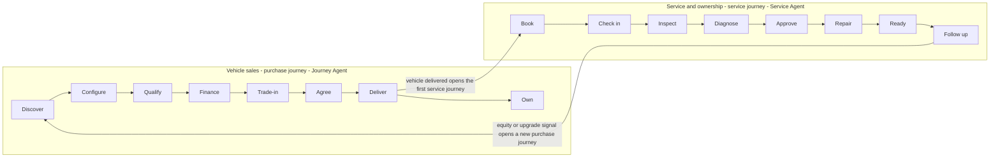

# Automotive Retail Operations powered by Agentic AI: overview and use cases

This document is for business readers at automotive OEMs, dealer groups and
partners who want to know what the solution does, which problems it addresses
and how its agents work. It needs no technical background. The architecture is
in [03-technical-architecture.md](03-technical-architecture.md) and the
deployment guide in [04-deployment.md](04-deployment.md).

## What it is

Automotive Retail Operations powered by Agentic AI is a deployable reference
solution on AWS for the work an OEM and its franchised dealers share with the
customer: selling a vehicle, servicing it, and bringing the owner back for the
next one. It is built on an orchestration layer called Intelligent Sales &
Service Orchestration.

- **Seven agents** do the work across the two business processes and the OEM
  level above them. Each one is named for its job (Discovery Agent, Journey
  Agent, Sales Agent, Trade-In Agent, Campaign Agent, Field Sales Agent, Service
  Agent).
- **One web console** joins five apps behind one sign-in: the Dealer Console
  (sales floor and service desk), the OEM Workspace, the Marketing Studio, the
  Customer Web (Shop and My Garage) and the Admin Console. Each person lands on
  the home screen for their role and sees the agents that work for them.
- **Amazon Quick** hosts the analytics dashboards and the Field Sales Agent's
  chat and document Flows for OEM field teams.
- **It runs in your own AWS account.** Scripts deploy the whole solution,
  verify it and tear it down. It ships with synthetic data for two markets, the
  United States and Germany, with fictional brands whose lineups and prices are
  derived from public data. It contains no real customer records.

## The problem it solves

A vehicle purchase and its service visits cross many systems that each optimise
their own step: the CRM owns the lead, the dealer management system (DMS) owns
the deal and the repair order, valuation tools own the trade, marketing
platforms own the campaign, and scheduling and inspection tools own the service
visit. None of them sees the whole customer, so the customer falls through the
gaps at each handoff: from the website to the showroom, from the sales floor to
the F&I office, from delivery to the first service, and from the service lane
back to the next purchase.

On the sales side, buyers move between online and in-store steps, and the
handoff between the two is where context gets lost:

- Most buyers want a mix: 63% of recent buyers said the ideal purchase combines
  online and in-person steps, while 7% bought entirely online.
  - Source: [Cox Automotive, 2025 Car Buyer Journey Study (January 2026)](https://www.coxautoinc.com/insights/cox-automotive-car-buyer-journey-study-finds-efficiency-digital-tools-and-ai-drive-record-satisfaction/)
- Buyers want to do more online than the tools let them: 48% want to apply for
  credit online but 33% do, and 40% want to choose F&I products online but 16% do.
  - Source: [Cox Automotive, 2025 Car Buyer Journey Study (January 2026)](https://www.coxautoinc.com/insights/cox-automotive-car-buyer-journey-study-finds-efficiency-digital-tools-and-ai-drive-record-satisfaction/)

On the service side, fixed operations carry the dealership's profit, yet dealers
are losing service customers, often right after the sale:

- Fixed operations generated 52.8% of total dealership gross profit in the
  second quarter of 2026.
  - Source: [Presidio-NCM Average Dealership Performance Benchmark, Q2 2026](https://thepresidiogroup.com/q2-2026-presidio-ncm-average-dealership-performance-benchmark/)
- Service, parts and body shop made up 13.6% of total dealership sales dollars
  in the first half of 2026.
  - Source: [NADA Data 2026: Midyear Report](https://www.nada.org/media/4694/download?inline)
- In 2025, 54% of owners of vehicles two years old or newer had them serviced at
  the dealership that sold them, down from 72% in 2023.
  - Source: [Cox Automotive Service Industry Study 2025 (November 2025)](https://www.coxautoinc.com/insights/new-cox-automotive-study-finds-dealerships-have-lost-12-of-service-visits-to-competition-since-2018/)
- Dealerships handled 12% fewer service visits in 2025 than in 2018.
  - Source: [Cox Automotive Service Industry Study 2025 (November 2025)](https://www.coxautoinc.com/insights/new-cox-automotive-study-finds-dealerships-have-lost-12-of-service-visits-to-competition-since-2018/)
- 45% of owners were dissatisfied with their dealership service experience,
  mainly because of unexpected costs and poor communication.
  - Source: [Cox Automotive Service Industry Study 2025 (November 2025)](https://www.coxautoinc.com/insights/new-cox-automotive-study-finds-dealerships-have-lost-12-of-service-visits-to-competition-since-2018/)
- Service feeds the next sale: owners who service their car at the dealership
  are much more likely to buy their next car there (74% in the Cox study).
  - Source: [Cox Automotive Service Industry Study 2025 (November 2025)](https://www.coxautoinc.com/insights/new-cox-automotive-study-finds-dealerships-have-lost-12-of-service-visits-to-competition-since-2018/)
- Over half of owners facing a major repair would consider a trade-in, yet few
  are told what their vehicle is worth during the service visit.
  - Source: [Cox Automotive Service Industry Study 2025 (November 2025)](https://www.coxautoinc.com/insights/new-cox-automotive-study-finds-dealerships-have-lost-12-of-service-visits-to-competition-since-2018/)

The solution gives each handoff an owner, keeps the context with the customer,
and lets agents do the routine preparation so people spend their time with the
customer.

## Two business processes, one customer

The solution runs two connected processes. They share one customer record, one
vehicle record, one console and one event stream.

### Vehicle sales: the purchase journey

Discover → Configure → Qualify → Finance → Trade-in → Agree → Deliver → Own.

The Journey Agent owns this journey. A stage moves forward only when the context
it needs is recorded, for example a saved build before qualifying, a finance
offer before the trade-in, and a deal structure with completed compliance checks
before delivery. The Discovery, Sales and Trade-In Agents serve the stages in
between. A customer has at most one active purchase journey; Own is a resting
state, so a repeat purchase opens a new journey linked to the previous one.

### Service and ownership: the service journey

Book → Check in → Inspect → Diagnose → Approve → Repair → Ready → Follow up.

The Service Agent owns this journey. A visit cannot leave check-in without a
repair order, cannot leave inspection without recorded findings, and cannot
start repair without a priced estimate and the customer's own decision on it.
The DMS stays the system of record for the repair order and the invoice; the
solution mirrors it and never replaces it.

### How they connect

*Text fallback:* the purchase journey runs from Discover to Own under the
Journey Agent, and the service journey runs from Book to Follow up under the
Service Agent. Marking a vehicle delivered opens its first service journey.
When a service follow-up shows the owner is in positive equity or near the end
of a lease, a sales handoff opens a new purchase journey that starts at
Discover.

The two supervising agents never drive each other. They meet through events:

- **Delivery opens ownership.** When the delivery coordinator marks a vehicle
  delivered, the purchase journey moves to Own and the Service Agent opens the
  vehicle's first service journey.
- **Service opens the next sale.** When an owner in service follow-up turns
  equity-positive, the Service Agent flags it; a service advisor hands the
  customer to sales, which opens a new purchase journey marked as sourced from
  the service lane, with the service context attached.
- **Declined work stays service.** Declined repairs come back as service
  reminders that re-present the original finding, never as sales messages.

## The seven agents

| Agent | What it does | Who it serves |
|---|---|---|
| Discovery Agent | Turns lifestyle and budget into a ranked, explained shortlist of trims with in-stock vehicles, price build, incentives and cost of ownership; re-ranks open shopping journeys each morning | Shoppers on the brand website; sales advisors; inventory managers |
| Journey Agent | Owns the purchase journey: checks each handoff, picks the next best action, builds the Sales Package, runs follow-up plays, nurtures consented prospects and answers customer questions from their own record | Sales advisors, BDC agents, delivery coordinators, general managers, OEM customer-experience teams, shoppers |
| Sales Agent | Works the sales floor and the F&I desk: contextual suggestions, objection coaching, incentives, deal scenarios, menu recommendations, compliance checks, first responses to leads and a cited assistant chat | Sales advisors, BDC agents, F&I managers |
| Trade-In Agent | Values the trade, works out equity and payment change, watches for customers turning equity-positive or nearing lease end, and recommends what to do with each trade and which service-drive vehicles to acquire | Sales advisors, inventory and used-car managers, owners |
| Campaign Agent | Attributes marketing spend to delivered vehicles, drafts budget-shift requests for approval, refreshes audiences and writes the nightly Store Cockpit insights | OEM marketing and finance, dealer general managers |
| Field Sales Agent | Prepares the OEM district manager's week: dealer performance, alert triage, account plans, meeting packages, scenarios and comms digests, all within OEM policy rules | OEM district managers, regional leads, incentive (C&I) planners, sales operations, finance |
| Service Agent | Owns the service visit end to end: booking, inspection, sourced estimates, customer approval, parts, promise times, follow-up, predictive maintenance and the handoff back to sales | Service advisors, technicians, parts specialists, service managers, owners |

## Use cases

The use cases are grouped by process. Each one names the problem, what the agent
does, and the outcome it is built for. The persona-by-persona view of the same
work is in [02-personas-and-benefits.md](02-personas-and-benefits.md).

### Vehicle sales

#### Discovery (Discovery Agent)

- **Problem.** Shoppers arrive with a lifestyle and a budget, not a trim code.
  Advisors search inventory by hand, and the shortlist a shopper builds online
  is often not the one the advisor sees in the store.
- **What the agent does.** A short intake (at most four follow-up questions)
  becomes a ranked shortlist of trims. Each match shows why it ranks where it
  does, whether matching vehicles are in stock at the dealer, a price build with
  current incentives, and an electric-versus-combustion cost-of-ownership
  comparison calculated from the market's energy, fuel and tax settings. Saving
  a build moves the journey forward. Each morning the agent re-ranks open
  shopping journeys and alerts the advisor when a better match arrives in stock.
- **Outcome.** The shopper and the advisor work from the same explained
  shortlist. No price is shown that a tool did not return, and every figure
  carries its source.

#### Journey orchestration (Journey Agent)

- **Problem.** Nobody owns the funnel from first touch to delivery. Context is
  lost between the website, the BDC, the advisor, the F&I office and the
  delivery bay, and prospects go cold without anyone noticing.
- **What the agent does.** It keeps the journey state and checks the required
  context before any stage change, recording the event before the state moves.
  It picks the next best action for the stage, assembles a Sales Package by
  asking the Discovery, Sales and Trade-In Agents for their parts, and runs
  plays when triggers fire (a stalled journey gets a callback brief, a customer
  turning equity-positive gets an upgrade pitch). It nurtures consented
  prospects on a cadence the OEM customer-experience team publishes, with quiet
  hours, caps and stop rules. It answers customer questions from the customer's
  own build, offer, valuation and dealer hours, and passes credit-decision,
  legal and safety-recall questions to a person. Ownership of a journey changes
  only through an accepted handoff that creates a task for the receiver.
- **Outcome.** Handoffs arrive complete, stalled journeys surface on their own,
  and customers get cited answers or a person, never a guess.

#### Live sales assistance (Sales Agent)

- **Problem.** With the customer in front of them, advisors juggle the CRM,
  incentive bulletins, the deal desk and objections. F&I managers rebuild
  payment scenarios by hand and track compliance checks across systems.
- **What the agent does.** On the floor it offers stage-aware suggestions that
  cite a recent activity, listens for objections and drafts a short response
  anchored to the store's own strategy library and its recorded success rate,
  and shows incentives and in-segment comparisons. On the deal worksheet it
  builds term, rate and payment scenarios across lender offers, scores how
  likely the customer is to take each F&I product, requests lender decisions,
  and blocks the push to the DMS until the OFAC, identity-theft Red Flags,
  adverse-action, disclosure and fee checks are clear. For new leads it drafts a
  first response. Its Assistant chat answers with citations, and in agent mode
  it plans its own use of eleven tools such as knowledge search, incentives,
  trade equity, follow-up drafts and tasks. A customer message that it drafts is
  held for a person unless the store has raised that action's autonomy level.
- **Outcome.** Advisors spend the conversation on the customer, the advice on
  the floor and in the chat comes from one engine, and no deal reaches the DMS
  with an open compliance check.

#### Trade-in and upgrade (Trade-In Agent)

- **Problem.** Equity and lease-end timing are worked out only when a customer
  asks, so trades are captured late and upgrade moments pass. Decisions about
  accepted trades and used-stock buying rely on instinct.
- **What the agent does.** It values the trade from guidebook-anchored data,
  adjusts for mileage and condition, and works out payoff, equity and the
  payment change against the active offer, showing the formula. A nightly scan
  flags customers who turn equity-positive and leases entering the upgrade
  window, which triggers the upgrade play. It recommends keeping, retailing,
  wholesaling or auctioning each accepted trade, and lists service-drive
  vehicles worth acquiring with an offer range. Owners see their own trade view
  in My Garage.
- **Outcome.** Equity conversations happen at the right time and the trade is
  captured in the same journey. The agent never contacts a customer on its own.

### Service and ownership

#### Service lane (Service Agent)

- **Problem.** Inspection findings are often not presented to the customer,
  estimates take time to build, customers call for status, parts waits are
  invisible until a promise is missed, and declined work is forgotten.
- **What the agent does.** It predicts the next service from mileage and
  history and books it. At check-in it opens the repair-order mirror. The
  technician's multi-point inspection marks each item green, yellow or red, and
  yellow or red items cannot be submitted without photo, video or voice
  evidence. The agent turns findings into a priced estimate line by line (labor
  operation, labor time, parts and warranty coverage, each with a source),
  presents it to the customer through a secure link, and records the customer's
  decision on each line. It tracks parts and line status, clears a parts hold
  when the last part arrives, notifies the customer when the vehicle is ready,
  and follows up declined work at 30, 60 and 90 days by re-presenting the
  original finding. Before the lane opens it recommends a qualified technician
  for each booked visit (high-voltage work only to certified staff), parts to
  stage and promises that already slip. Technicians get code look-ups, procedures
  and bulletins, and never see customer contact details or pricing.
- **Outcome.** Findings reach the customer with evidence, estimate approval
  stays the customer's decision (no setting can automate it), slipping promises
  surface early, and declined work comes back on schedule.

### OEM level, above both processes

#### Campaign ROI (Campaign Agent)

- **Problem.** OEM marketing cannot see whether campaign spend turned into
  delivered vehicles, so budget moves rest on clicks and leads rather than
  sales.
- **What the agent does.** It attributes spend to the journeys each campaign
  started and to the vehicles delivered, by campaign and dealer, with cost per
  delivery, return on investment and the funnel by source. Each night it drafts
  budget-shift requests into the finance approval queue when the projected lift
  clears a threshold. It builds rule-based audiences and exports them with
  hashed identifiers only, refusing customers who opted out. Dashboards and
  natural-language questions over the same data live in Amazon Quick. Each night
  it also writes the dealer Store Cockpit insights from the store's own figures.
- **Outcome.** Budget decisions rest on attributed deliveries. Approving a
  request records the decision; the agent never changes spend.

#### OEM field sales (Field Sales Agent)

- **Problem.** District managers prepare dealer visits from spreadsheets,
  slide decks and notes, plans start from a blank page, and franchise rules make
  some advice risky to put in writing.
- **What the agent does.** In the OEM Workspace it shows each district's dealer
  performance, composites, alerts, weekend projections, EV readiness, compliance
  and scenario planning, and answers questions with a citation for every figure.
  It drafts account plans tied to concrete metric gaps; a plan is published only
  after a person approves it in an approval workflow. Every Monday a district
  cycle drafts a plan for each dealer below the health threshold. In Amazon
  Quick it is a native chat agent with eight document Flows (account plan,
  opportunity brief, win strategy, action plan, contact report, meeting package,
  district roll-up and sales-ops digest) grounded in indexed notes, prior plans
  and bulletins, and in OEM data read through a scoped connection. OEM policy
  rules check both the question and the answer: requests to cut a dealer's
  wholesale orders, discuss termination, set dealer prices, make personnel
  decisions or promise allocation are declined with a safe alternative.
- **Outcome.** The week starts prepared and every figure is cited. The agent
  never publishes a plan, contacts a dealer or changes an allocation on its own.

### Across both processes

#### Cross-process hand-offs

- **Problem.** The moments between departments (delivery to first service,
  service lane to sales, dealer to OEM data) depend on someone remembering to
  pass the customer on.
- **What the agents do.** Delivery opens the first service journey
  automatically. The Service Agent flags equity-positive owners in follow-up, a
  service advisor hands them to sales in one action, and the Journey Agent opens
  a new purchase journey with a full-preparation play; the Service Lane screen
  gives the sales advisor an upsell brief with the equity figures. Predictive
  part wear raises a Lead Desk lead with a customer offer. Dealer staff who need
  OEM data (accounts, alerts, incentive programs) get it through a scoped,
  cited connection rather than direct access to OEM records.
- **Outcome.** Each handoff is a record and a task, not a hallway conversation,
  and the source of a sale (for example, the service lane) stays attached to the
  journey through delivery so the department that earned it gets the credit.

#### Proactive scheduled work

- **Problem.** Morning preparation, follow-ups and monitoring compete with live
  customers for staff time and are the first things to slip.
- **What the agents do.** Twelve scheduled jobs run for each market: the
  stalled-journey sweep, the nurture cadence, the morning build re-score, the
  nightly equity monitor, the service-lane repurchase monitor, the morning shop
  load (technician dispatch, parts to stage and promise checks), hourly
  declined-work and due-service reminders, the nightly predictive part watch,
  nightly campaign attribution, the weekly district cycle, the nightly store
  digest, and a weekly autonomy review that ships switched off.
- **Outcome.** The work is done before the shift starts. At the shipped settings
  the jobs write recommendation cards, leads and drafts for people to act on and
  send nothing to a customer.

## What makes it agentic

The agents act without waiting for a click, inside limits the dealer and the
OEM control.

- **Events.** State changes are published as events (a vehicle delivered, a
  journey stalled, equity turning positive, an estimate line decided), and
  agents react to them: opening a service journey, running a play, closing the
  loop on a recommendation.
- **Schedules.** The twelve jobs above prepare work on a clock, for both
  markets, and each run is recorded so the console shows when it last ran.
- **Autonomy levels with human approval.** Every action with an external
  effect has its own level: off, recommend, act with approval, act and notify,
  or autonomous. Everything ships at recommend, so an agent proposes and a
  person acts. Administrators raise levels one action at a time, with version
  history and rollback. Some limits cannot be raised by any setting: budget
  shifts and plan publishing stop at approval, and incentive allocation and the
  customer's estimate decision stay with people. Account-plan publishing runs
  through an approval workflow that pauses until a person decides, and nobody
  can approve their own request.
- **Guardrails.** Every model call passes a managed safety guardrail that blocks
  credit decisions, legal interpretation, safety-recall advice, instructions to
  dealers about wholesale, allocation or pricing, dealer termination and
  personnel decisions; it also filters harmful content, scare language and
  sensitive identifiers. Customer and assistant questions pass a fixed
  refuse-or-escalate check before any model is asked, and OEM field answers pass
  the OEM policy rules on the way in and on the way out.
- **Grounded and cited answers.** Rules and calculations decide; the model
  phrases. Ranking, pricing, equity, attribution and routing are deterministic
  code, every figure carries a reference to the record it came from, and the
  model is asked only to phrase answers from facts the tools already retrieved.
  When the model is unavailable, a plain-text answer built from the same facts is
  returned and labelled as such.
- **Learning from outcomes.** Every recommendation records whether it was
  shown, accepted, dismissed and later converted. That evidence feeds the
  administrator's agent dashboard and the weekly review that can propose a
  higher autonomy level for an action people keep accepting, or a lower one for
  an action they keep dismissing.

## Out of scope

The solution deliberately does not cover:

- Payments, e-contracting and e-signature.
- More than one OEM in a single deployment (one OEM per stack).
- Native mobile apps; the console is responsive web.
- Real-time bidding on ad platforms: the Campaign Agent recommends, people
  apply budgets.
- A buyer portal for fleet and commercial customers (fleets are OEM accounts),
  an OEM after-sales and warranty analytics view, and supplier personas.
- Replacing the DMS: the repair order and invoice stay in the DMS.
- Technician time-clock and payroll, warranty claim submission, body-shop and
  collision estimating, and loaner-fleet management (availability is read for
  booking only).
- Manufacturing and plant scheduling, supplier procurement, and inter-store
  vehicle transfers.

Some capabilities are optional or have a defined current scope, for example
customer memory, a trained personalization model, progressive token streaming,
Amazon Connect voice and live DMS or CRM connectors. They are listed in
[03-technical-architecture.md](03-technical-architecture.md#current-scope-and-options).
