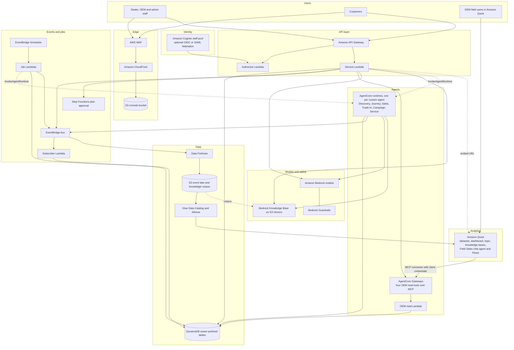
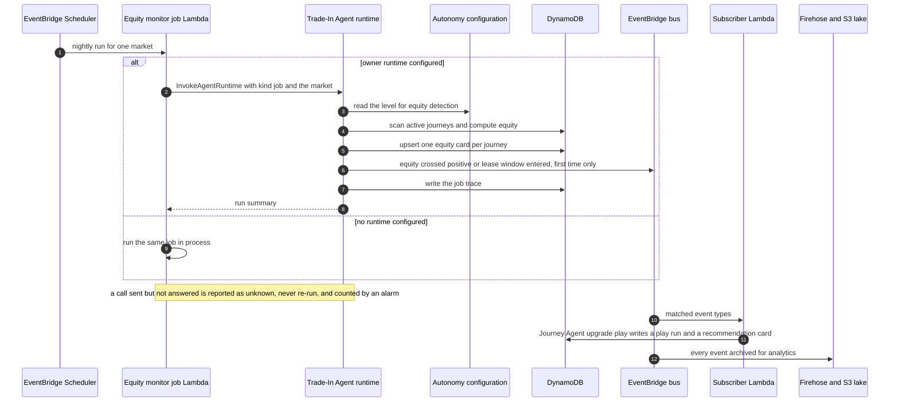
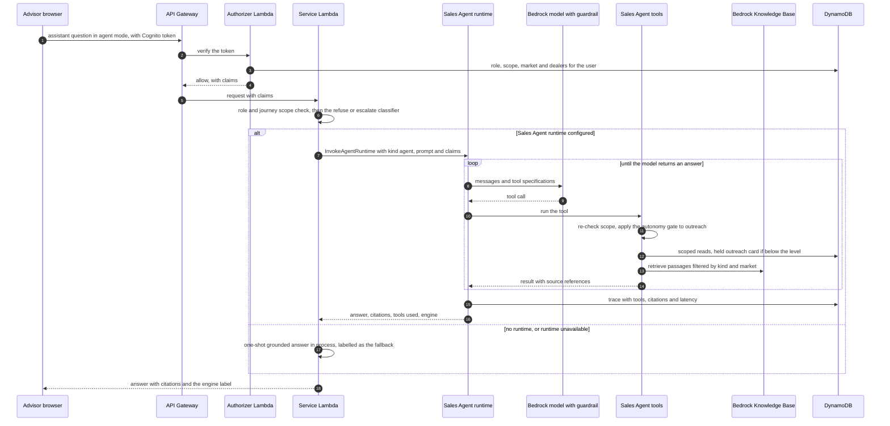

# Technical architecture

This document describes Automotive Retail Operations powered by Agentic AI end
to end, as it is built today, for architects and engineers evaluating or
extending it. The business view is in
[01-overview-and-use-cases.md](01-overview-and-use-cases.md); deploying it into
your own account is covered in [04-deployment.md](04-deployment.md).

Resource names below use the pattern `retail-ops-<env>-…`, where `<env>` is the
environment name the deployers use. Nothing here is specific to one AWS account.

## Summary

The solution is a serverless, event-driven application on AWS. All business
logic lives in one Python 3.12 service package that is exposed three ways:

1. a **REST API** (Amazon API Gateway with a token authorizer and one service
   Lambda) that the console calls;
2. **one Amazon Bedrock AgentCore runtime per custom agent**, which serves that
   agent's tools, its scheduled jobs and, for the Sales Agent, a reasoning loop;
3. **scheduled jobs** on Amazon EventBridge Scheduler, which hand agent-owned
   work to the owning agent's runtime.

The agents are deterministic, tested tool modules. One of them, the Sales
Agent, adds a Strands reasoning agent on Amazon Bedrock that plans over its
tools. Bedrock phrases grounded answers at defined points, every model call
carries a managed Bedrock Guardrail, retrieval uses a Bedrock Knowledge Base,
and every generative step has a deterministic fallback. State lives in Amazon
DynamoDB, changes are published as typed events on Amazon EventBridge, events
land in an Amazon S3 lake for analytics in Amazon Quick, and a Next.js console
is served from Amazon CloudFront behind Amazon Cognito sign-in. The Field Sales
Agent for OEM field teams is native to Amazon Quick and reaches operational data
only through an AgentCore Gateway.

## Layers

| Layer | What it is | Main AWS services |
|---|---|---|
| Console | One Next.js 14 static site with five apps in one shell: Dealer Console (sales floor and service desk), OEM Workspace, Marketing Studio, Customer Web (Shop, My Garage) and Admin Console; 76 pages; persona-gated navigation and an agent panel on every staff screen | Amazon S3, Amazon CloudFront, AWS WAF |
| API | One REST API, a token authorizer Lambda and one service Lambda that routes roughly 300 routes; every request carries a correlation id | Amazon API Gateway, AWS Lambda |
| Agents | Seven agents: six custom agents in their own AgentCore runtimes (one of them with a Strands reasoning loop) and the Field Sales Agent in Amazon Quick; two AgentCore Gateways for cross-persona OEM reads | Amazon Bedrock AgentCore (Runtime, Gateway, Code Interpreter), Amazon Quick |
| Events | A custom event bus with a catalogue of 82 event types, a subscriber Lambda with a dead-letter queue, twelve scheduled jobs and a human-approval state machine | Amazon EventBridge, EventBridge Scheduler, Amazon SQS, AWS Step Functions |
| Data | 68 owner-prefixed DynamoDB tables, an S3 event lake with a Glue catalogue and Athena, a 538-document knowledge corpus, and versioned configuration tables | Amazon DynamoDB, Amazon S3, Amazon Data Firehose, AWS Glue, Amazon Athena |
| Analytics | Direct-query datasets over the lake, a natural-language topic, a Campaign ROI dashboard, knowledge bases and the Field Sales chat agent and Flows, shared by group | Amazon Quick |
| Identity | A Cognito staff pool with 19 role groups, optional OIDC or SAML federation, an administrator allowlist, customer one-time links, and RBAC plus organizational scope enforced in the service | Amazon Cognito, AWS IAM, AWS Secrets Manager |
| Safety | Managed guardrails on every model call, a refuse-or-escalate classifier, the OEM policy rules engine, per-action autonomy levels with hard ceilings, deterministic fallbacks and data classification | Amazon Bedrock Guardrails |
| Operations | Traces per request, CloudWatch alarms per Lambda, an agent health panel, a golden-prompt evaluation harness and scripted deploy, verify and teardown | Amazon CloudWatch |

## Component view

*Text fallback:* staff and customers load the console from CloudFront (behind
WAF, from a private S3 bucket) and call API Gateway, where an authorizer Lambda
validates Cognito tokens. The service Lambda reads and writes DynamoDB,
publishes events, starts the approval state machine, reads OEM data through the
AgentCore Gateway, calls Bedrock and the Knowledge Base, and invokes the agent
runtimes for agent work. Scheduler drives job Lambdas, which invoke the owning
agent's runtime. The event bus feeds a subscriber Lambda and, through Firehose,
the S3 lake, which Glue and Athena expose to Amazon Quick. Every model call is
checked by a Bedrock Guardrail. The Knowledge Base indexes the corpus stored in
the lake bucket. OEM field users work in Amazon Quick, whose MCP connector
reaches OEM data only through the Gateway, and the console embeds Quick
dashboards through embed URLs.

## Agent architecture

### Tool agents and one reasoning agent

"Agent" means two layers here:

- **Tools.** Each agent is a domain module whose functions are its tools:
  ranking vehicles, checking a stage handoff, computing equity, building an
  estimate, attributing spend. Tools are deterministic and tested, every figure
  they return carries a `source_ref` to the record it came from, and they are
  invoked by a click (an API route), a clock (a scheduled job), an event (a bus
  subscriber) or another agent.
- **Reasoning.** A Strands agent on Amazon Bedrock chooses and sequences tools.
  Today one exists: the Sales Agent's Assistant in agent mode, which plans over
  eleven tools (lifecycle context, recent activity, suggestions, incentives,
  trade equity, knowledge search, objection strategy, customer memory, draft
  follow-up, create task and send outreach). Each tool re-checks the caller's
  scope, every `source_ref` becomes a citation, and send outreach is held for a
  person below the configured autonomy level.

The other five custom agents run as deterministic tool agents. Each can be
promoted to a reasoning agent on its own once its golden-prompt suite shows
parity (see [Observability and evaluation](#observability-and-evaluation)).
This keeps model spend and latency off paths that do not need planning, such as
nightly sweeps and the Sales Package.

### One AgentCore runtime per custom agent

The Discovery, Journey, Sales, Trade-In, Campaign (its budget-shift
recommendation step) and Service Agents each have their own AgentCore runtime.
The runtime name is derived from the environment name and the agent, so each
agent has its own deployment, version history, log group and failure domain.

- **Packaging.** Each runtime is a direct code deployment: a Linux arm64 zip
  holding only that agent's import closure plus its dependencies (`boto3`, and
  `strands-agents` for the Sales Agent) on the managed Python 3.12 runtime. No
  containers or image registry are involved.
- **Contract.** Each runtime serves the AgentCore HTTP contract (`/ping`,
  `/invocations`) for its own agent only. A request is one of three kinds:
  `tool` (run one registered tool with validated arguments), `agent` (run the
  reasoning loop; Sales Agent only) or `job` (run one of the agent's scheduled
  jobs). Every request carries the caller's claims and a correlation id; the
  runtime re-validates the claims and scope, refuses another agent's code, and
  returns one self-citing result envelope.
- **What goes to a runtime.** Only agent work: the Sales Agent reasoning turn,
  the Sales Package, the Campaign Agent's two budget-shift requests and the nine
  agent-owned scheduled jobs. Every other route (boards, desks, worksheets,
  cockpits) runs in the service Lambda as a read model, so screens render
  without an agent in the request path.
- **Identity.** The six runtimes share one execution role in the current
  release. User-facing access control is enforced on the forwarded claims, not
  by the role.
- **Registry.** One agent registry in code lists each agent's tools, jobs,
  reasoning entry point, the agents it may call and the payload shapes. The
  deployer, the runtime dispatcher and the service-side client all read it.

### Agent-to-agent calls

The Journey Agent builds the Sales Package by calling the Discovery, Sales and
Trade-In Agents' runtimes in parallel with A2A-shaped requests (`kind: tool`,
the caller's claims, the correlation id) over `InvokeAgentRuntime`, each with
its own time budget. A specialist that does not answer in time becomes an error
card in the package rather than a failed request. If the Journey Agent's own
runtime does not answer in time, the API returns a "building" response and the
console polls for the finished package.

The two supervising agents, Journey and Service, never call each other's
runtime. They meet only through events (for example, a delivered vehicle or a
service-to-sales handoff), so one never drives the other's state.

### In-process fallback

The service and job Lambdas read a map from agent to runtime. When an agent has
no runtime configured, or an operator disables it, the same function runs
in-process in the Lambda. Local development and the offline test suite use this
path with no AWS at all. A call that was sent to a runtime but not answered is
never re-run in-process, so an effectful job or tool cannot run twice; the job
reports the unknown outcome and an alarm counts it.

### Field Sales Agent, native to Amazon Quick

The Field Sales Agent serves OEM district and regional managers, incentive
planners, sales operations and finance. It has no AgentCore runtime by design,
because its work is document generation and cited question answering for
knowledge workers, which is what Amazon Quick provides:

- **In Amazon Quick**, the deployment scripts create a space, a chat agent, nine
  knowledge bases over the corpus (CRM notes, prior plans, bulletins, product
  guides, objection strategies, repair procedures, service bulletins and more),
  a natural-language topic over the journey funnel, a Campaign ROI dashboard,
  and eight published Flows: account plan, opportunity brief, win strategy,
  action plan, contact report, meeting package, district roll-up and sales-ops
  digest. Each Flow collects its inputs, has the chat agent fetch OEM facts
  through the MCP connector, reads the knowledge bases or topic, and drafts the
  document for review. The agent's instructions carry the OEM policy rules.
- **In the console**, the OEM Workspace screens run on deterministic planner
  tools in the service Lambda, and the workspace assistant answers through the
  API with Bedrock, checked by the OEM policy rules engine on input and output.
  The weekly district cycle runs as a scheduled job in its own Lambda.

### Cross-persona Gateway boundary

Every DynamoDB table belongs to one data owner, shown in its prefix: `OEM_`,
`DEALER_`, `CUST_` or `PLAT_`. Dealer-side code never reads `OEM_` tables
directly; a direct read across owners from a caller of another persona is
refused. Instead, two AgentCore Gateways (MCP protocol) expose four read tools:
list accounts, get account, get alerts and get incentive programs. One Lambda
with its own least-privilege role backs them; it re-checks the caller's scope,
strips OEM-internal fields, and returns every record with a citation.

- The **IAM-authenticated gateway** serves the service Lambda and the runtimes.
- The **JWT-authenticated gateway** serves Amazon Quick. It validates tokens
  issued by the Cognito pool.

OEM roles read down across their dealers directly; the Administrator, as a
platform operator, does too. Dealer personas, including an Administrator
viewing the console as one, always go through the Gateway.

### The Quick connector

Amazon Quick's MCP connector authenticates to the JWT gateway with a Cognito
client-credentials token: a dedicated machine client and a resource-server
scope for OEM reads, with the client secret in AWS Secrets Manager. The OEM read
Lambda derives a service-level OEM scope from the token and ignores any claims
the model passes as arguments. The connector is created once in the Quick
console (the Quick API does not accept the MCP connector type), then a
deployment re-run links it to the space and the chat agent; see
[04-deployment.md](04-deployment.md#amazon-quick).

## Events and scheduled jobs

### Event bus

A custom EventBridge bus, `app-bus-<env>`, carries every state change as a
typed event. The service code holds a catalogue of 82 event types (journey,
service, estimate, repair order, parts, trade, deal, task, handoff, approval,
alert, plan, recommendation and configuration events); `emit` refuses a type
that is not in the catalogue. Journey stage changes are written event first:
the append-only event log row is written, then the journey row flips, then the
event is published, so the audit trail never lags the state.

- A rule sends the subscribed event types to a **subscriber Lambda** with an
  SQS dead-letter queue. Subscribers run plays (for example, a stalled journey
  gets a callback brief, equity turning positive gets an upgrade pitch), open
  the first service journey on `vehicle.delivered`, and join later events to
  earlier recommendations to record conversions.
- A second rule sends **every event to the lake** through Firehose.
- Locally, the same subscribers run in-process, so behaviour is identical with
  and without AWS.

### Scheduled jobs

Twelve jobs are defined in one table in the scheduler deployer and run once per
market (US and Germany). The morning shop load has one schedule per market at
05:00 local time, so there are thirteen schedules. Every job the agent panel
shows ships enabled; the autonomy review ships disabled. Nine jobs run in their
owner agent's runtime when one is configured.

| Job | Owner | Schedule (UTC unless noted) | What it does at the shipped `recommend` level |
|---|---|---|---|
| Equity monitor | Trade-In Agent | Nightly, 06:00 | Recomputes equity; one card per journey turning positive; emits the equity and lease-end events once |
| Nurture tick | Journey Agent | Every 6 hours | Finds due nurture touches, re-checks consent, quiet hours and caps, writes a card per touch |
| Stall sweep | Journey Agent | Daily, 05:30 | Flags journeys idle past the stall threshold once and emits the stalled event, which runs the callback-brief play |
| Rescore profiles | Discovery Agent | Daily, 05:45 | Re-ranks shopping journeys; emits a match event when the top trim is in stock at the home dealer |
| Service-lane monitor | Service Agent | Nightly, 07:00 | Service follow-ups turning equity-positive become sales-handoff cards |
| Shop load | Service Agent | 05:00 local per market | Technician dispatch, parts staging and promise-slip recommendations for the day's booked visits |
| Service follow-up tick | Service Agent | Hourly | Due declined-work reminders and due-service cards |
| Predictive scan | Service Agent | Nightly, 06:15 | Predicted part-wear leads for the Lead Desk and customer offers, capped per store |
| Nightly attribution | Campaign Agent | Nightly, 08:00 | Recomputes campaign return; drafts budget-shift approval requests when projected lift clears the threshold |
| District cycle | Field Sales Agent | Mondays, 05:00 | Composites, alerts and draft account plans for dealers below the health threshold |
| Store digest | Campaign and Service Agents | Nightly, 06:30 | Writes the Store Cockpit and Service Cockpit insights with Bedrock, skipping stores whose figures did not change |
| Autonomy promotion | Platform | Mondays, 06:00 (ships disabled) | Turns sustained acceptance or dismissal into proposed autonomy changes |

Jobs make no model calls, with one exception: the store digest exists to write
with Bedrock and runs in its own Lambda. Each applied run writes a trace, which
is what the agent panel shows as "last ran".

### A scheduled job, end to end

*Text fallback:* the scheduler starts the equity monitor job Lambda for one
market. If the Trade-In Agent has a runtime, the Lambda sends it a job request;
otherwise it runs the same job itself. The job reads the autonomy level, scans
active journeys, upserts one equity card per journey, emits the equity or
lease-window event the first time a journey qualifies, and writes a trace. A
call that was sent but not answered is reported as unknown and never re-run.
The bus delivers the events to the subscriber Lambda, which runs the Journey
Agent's upgrade play and writes a recommendation card, and archives every event
to the lake.

## Autonomy levels and approvals

Every action with an external effect (a message, a booking, a dispatch, an
order, a published document, a data change) has its own autonomy level, stored
as versioned configuration and read at run time:

| Level | Behaviour |
|---|---|
| off | The action does not run |
| recommend | The agent writes a recommendation card or task; a person acts (shipped default for every action) |
| act with approval | The action waits for a person's decision; budget shifts and plan publishing reach people this way, through the approval inbox and the plan-approval workflow |
| act and notify | The agent acts and posts a notification |
| autonomous | The agent acts |

- **Hard ceilings.** Nine actions have ceilings no configuration can raise:
  budget shifts and plan publishing stop at act with approval; incentive
  allocation and the customer's estimate decisions stop at recommend. Consent,
  quiet hours, the OEM policy rules and technician data masking are not
  autonomy settings at all.
- **Approvals.** One inbox holds deal exceptions, budget shifts, parts over a
  cap and act-with-approval actions. The requester can never decide their own
  request, and approving records a decision; it never applies a financial
  effect automatically (no code path changes campaign spend).
- **Account-plan publishing** runs on a Step Functions standard state machine
  with a task-token callback: submitting a plan starts an execution that pauses;
  a person with the approver role resumes it with approve or reject, and the
  plan status follows.
- **Outcome loop.** Every recommendation an agent shows is recorded as shown,
  accepted or dismissed, and later converted by a subscriber that joins the
  events that follow (an appointment booked, an estimate line approved, a
  vehicle delivered). Acceptance and conversion per action appear in the Admin
  Agents panel.
- **Autonomy promotion.** A weekly job (shipped disabled) proposes raising an
  action from recommend to act and notify when it has been shown often enough
  and accepted at a high rate, and lowering it when acceptance falls. It uses
  the same guarded publish path as a person: ceilings, versioning, audit and a
  task for the tenant administrator.

## Data

### Operational data

- **DynamoDB.** 68 on-demand tables named `retail-ops-<env>-<Owner>_<Name>`:
  39 `DEALER_`, 14 `OEM_`, 12 `PLAT_` and 3 `CUST_`. Key families are purchase
  and service journeys with their append-only event logs, the service reference
  set (labor operations, parts, diagnostic codes, coverage, inspection
  templates), OEM account planning (accounts, alerts, plans, incentive
  programs, guardrail events) and the platform set (users, organization
  hierarchy, traces, entity map, knowledge collections, configuration).
- **Versioned configuration.** Guardrail rules, the suggestion matrix,
  notification rules, feature flags, the connector registry, tenant settings,
  the nurture policy and autonomy levels are append-only configuration rows.
  Publishing a version changes behaviour on the next invocation without a
  redeploy, and a rollback is another publish.
- **Markets as configuration.** Currency, units, tax rules and energy defaults
  come from market records; the console has no currency or unit literals, and a
  lint check fails the build if one appears. Adding a market is a data change.
- **Synthetic data.** Deterministic packs for the US and Germany seed every
  table; brands are fictional and derived from public data, every generated
  figure carries a `source_ref`, and no real personal data is included.

### Event lake and analytics

- An EventBridge rule streams every event through Data Firehose into an S3 lake
  partitioned by date. Analytics mirrors and derived roll-ups (dealer sales,
  satisfaction, market intelligence, leads, campaigns) are added alongside.
- A Glue database catalogues 13 lake tables, queried through a dedicated Athena
  workgroup.
- Amazon Quick reads the lake through one Athena data source: a direct-query
  dataset per lake table, plus two custom-SQL datasets (the journey funnel, and
  campaign spend allocated over the journeys each campaign started), a topic for
  natural-language questions, and the Campaign ROI dashboard.

### Knowledge corpus and Knowledge Base

- **Corpus.** 538 Markdown documents (CRM notes, message templates, call
  transcripts, objection strategies, incentive bulletins, prior account plans,
  product guides, repair procedures and technical service bulletins), each with
  its `source_ref`, are exported to the lake bucket.
- **Bedrock Knowledge Base.** Built over that corpus with Amazon Titan Text
  Embeddings V2 and an Amazon S3 Vectors index, fixed-size chunking, and a
  metadata file per document so retrieval can filter by document kind and
  market. Retrieved chunks keep their `source_ref`, so citations resolve to the
  original record. If the Knowledge Base is unavailable, a keyword index over
  the same collections answers and the response says which engine ran.
- **Amazon Quick knowledge bases** index the same corpus for the Field Sales
  Agent, so the console and Quick cite the same documents.

### Data classification

| Class | Examples | Where it may appear |
|---|---|---|
| C1 public | Catalog, prices, incentives | Everywhere |
| C2 internal | Dealer sales, scores, alerts, plans | Console and Quick (by group); never the customer web |
| C3 personal | Names, contact details, messages | DynamoDB and the console within scope, the customer's own view; audience exports carry hashed identifiers only |
| C4 sensitive | Credit results, income, trade payoff, contract terms | The F&I desk and the customer's own view only |

Customer-facing payloads are built from explicit field allowlists, technicians
never receive contact data or pricing, trace queries are hashed, and
data-subject requests download a customer's records without C4 fields or delete
identity fields while keeping operational records.

## Model use and safety

### Where Bedrock is called

Every call is of the form "here are facts and passages the tools already
retrieved, with their source references; phrase an answer and add nothing".
Every call is made only in AWS mode, carries the guardrail, has a deterministic
fallback text, and reports `engine` in its response so the console can label
what answered.

| Purpose | Where |
|---|---|
| Grounded answers | Sales Agent assistant chat, customer questions (after the refuse-or-escalate check), OEM workspace assistant, marketing questions, service knowledge explanations of a finding or procedure |
| Short explanations | Why a vehicle fits, what the equity figures mean, the suggested response to an objection, the campaign insight, the OEM Today insight |
| Ordering candidates | Picking the next best action among the candidates the rules produced; ordering the morning-work cards. The model cannot add, remove or change an action |
| Planning | The Sales Agent reasoning loop |
| Nightly writing | The store digest's cockpit insights |

Default models are Anthropic Claude inference profiles: Claude Opus 4.5 for
phrasing and Claude Sonnet 4.5 for the Sales Agent loop. Both are deployment
settings. The Field Sales Agent in Amazon Quick uses Quick's own models.

### Guardrails

- **Main guardrail.** One managed Bedrock Guardrail (Standard tier, cross-region
  profile) on every call: six denied topics (credit or lending decisions, legal
  interpretation, safety-recall advice, wholesale, allocation or pricing
  instructions to a franchised dealer, dealer termination, personnel decisions);
  content filters at high strength and a prompt-attack filter on input; a
  scare-language word list plus managed profanity; anonymisation of sensitive
  identifiers such as social security, card and bank numbers on output; and a
  contextual grounding check (grounding 0.45, relevance 0.35). A
  grounding-only intervention returns the deterministic text built from the
  same facts; a topic intervention returns the guardrail's blocked message. A
  calibration set of 13 prompts that must pass and 8 that must be blocked runs
  after every change.
- **The store digest's own copy.** The nightly store digest uses a second
  guardrail with every policy of the main one, the grounding check relaxed to
  0.2 and the relevance check off, because the digest rewrites figures-only
  summaries whose paraphrasing the main check rejected. Only the digest Lambda
  uses it; if it is missing, the digest uses the main guardrail. The inventory
  tab insight stays figures-only in every store, because stocking advice to a
  dealer is a denied topic.
- **Refuse-or-escalate classifier.** Before any retrieval or model call,
  customer questions and assistant chat pass a deterministic classifier:
  credit-decision, legal and safety-recall questions (and, in the assistant,
  approval questions) return a handoff to a person instead of an answer.
- **OEM policy rules engine.** The Field Sales Agent's rules engine applies
  eight OEM policy rules to the user's text and to any generated output. Some
  block and return a safe alternative, some require approval, some warn; every
  match is logged. The rules are versioned configuration with a test harness in
  the Admin Console.
- **Deterministic fallbacks.** Ranking, gating, pricing, equity, attribution
  and routing never depend on the model. If Bedrock is throttled or unavailable,
  each call returns its fallback text and the response says so.

## Identity and access

- **Staff sign-in.** A Cognito user pool with 19 groups, one per assignable
  role. Staff sign in with username and password, or, optionally, through an
  enterprise OIDC or SAML identity provider attached to the pool's hosted UI.
  The authorizer accepts tokens from both app clients and maps a federated
  identity to the same user record, so role and scope are identical across
  sign-in methods.
- **Administrator allowlist.** The Administrator role is not a Cognito group.
  It is granted only to the federated identities listed in the deployment
  configuration, from the identity provider recorded on each row; any other
  federated sign-in without a user record is refused. The role cannot be
  assigned in the console or impersonated.
- **Customers.** Customers sign in with a purpose-bound, single-use magic link
  that is exchanged for a short-lived session bound to their customer id.
- **RBAC plus scope.** The token authorizer resolves each caller's role,
  organizational scope node, market and dealer set from the user and
  organization-hierarchy tables. The service enforces scope on every row it
  returns and every resource it reads; the screen list in the console is a
  convenience, not the control. Server-side masking removes fields a role may
  not see. Administrator actions taken as another persona ("View as persona")
  are audited under the administrator's identity.
- **Least privilege.** Each Lambda has its own IAM role with enumerated table
  ARNs and only the actions it uses; the Gateway Lambda reads only the tables
  its tools expose. The agent runtimes share one execution role in the current
  release.
- **Amazon Quick access is by group, not by row.** Quick content is shared with
  sharing groups (builders as owners, OEM role groups as viewers). There is no
  row-level security in Quick by design: anyone who can open a Quick dashboard
  or dataset sees all of its rows. RBAC and scope checks in the API and the
  Gateway boundary are unaffected. By default embeds use one shared reader;
  registering each console user as their own Quick reader is an option that is
  off by default.

## Edge security

- The console is a private S3 bucket behind CloudFront with origin access
  control; a CloudFront function maps clean URLs and dynamic routes to the
  static pages.
- An AWS WAF web ACL on the distribution applies AWS managed rule groups and a
  per-IP rate limit; an optional CIDR allowlist restricts the console to your
  network ranges.
- **No public entry points.** Nothing is reachable without the platform's
  authentication: API Gateway with the authorizer, or the console's CloudFront
  origin. Public Lambda function URLs are not used, and a CI test pins that.
- Secrets live in AWS Secrets Manager (for example the Quick machine client's
  secret and an optional identity-provider secret); the connector registry
  stores secret references, never values.

## Observability and evaluation

- **Traces.** Every request carries a correlation id that is written with the
  tools used, the engine and the latency to a traces table; the console's AI
  Log and each agent card's "last ran" read it. Runtime traces are marked with
  their transport.
- **Agent health.** The Admin Agents panel shows invocations, error rate, p50
  and p95 latency, guardrail blocks, and acceptance and conversion per action.
- **Alarms.** CloudWatch alarms on errors and throttles for every Lambda, and a
  metric filter and alarm per agent-owned job for runtime calls whose outcome is
  unknown. Each agent runtime has its own log group.
- **Golden prompts as the promotion gate.** An evaluation harness holds 36
  golden cases in six suites: the Sales Agent assistant (15), customer
  questions (7), the OEM workspace assistant (7), service explanations (3), the
  next-best-action supervisor (2) and morning-work ordering (2). Checks are
  deterministic: refusal or explanation, refusal category or guardrail rule,
  minimum citations, forbidden phrases (invented prices, claims of having sent a
  message, scare words), required tools and a latency cap. The offline mode runs
  without AWS and gates CI: every case must pass. Agent and API modes run the
  Sales Agent cases against Bedrock and against the deployed API, scored
  against a kept baseline, with an optional model-as-judge score that is
  advisory. A tool agent is promoted to reasoning only when its offline suite
  passes, its agent-mode results match or beat the baseline, and no case breaks
  the latency cap.

### A request through an agent

*Text fallback:* the advisor's question reaches API Gateway with a Cognito
token. The authorizer looks up the user's role, scope, market and dealers and
passes them on as claims. The service Lambda checks role and journey scope and
runs the refuse-or-escalate classifier, then sends the prompt and claims to the
Sales Agent's runtime. The Strands agent loops between the Bedrock model (with
the guardrail attached) and its tools; each tool re-checks scope, outreach is
held below the configured autonomy level, retrieval is filtered by document kind
and market, and every source reference becomes a citation. The runtime writes a
trace and returns the answer. If no runtime is configured or it is unavailable,
the service Lambda answers through the one-shot grounded path and labels it.

## Technology

| Area | Technology | Role in the solution |
|---|---|---|
| Console | Next.js 14, React 18, TypeScript, static export | Five apps in one shell, persona-gated, agent panel |
| Hosting and edge | Amazon S3, Amazon CloudFront, CloudFront Functions, AWS WAF | Private static hosting, URL rewrites, managed rules, rate limit, optional allowlist |
| API | Amazon API Gateway (REST), AWS Lambda (Python 3.12) | Token authorizer, service router, job Lambdas, subscriber, Gateway target |
| Agents | Amazon Bedrock AgentCore Runtime, Strands Agents SDK | One runtime per custom agent; the Sales Agent's reasoning loop |
| Cross-persona data | Amazon Bedrock AgentCore Gateway (MCP) | Scoped, cited OEM reads for dealer code and Amazon Quick |
| Computation | Amazon Bedrock AgentCore Code Interpreter | Audited calculations (inputs, code, result) with a restricted local fallback |
| Models | Amazon Bedrock (Anthropic Claude via the Converse API) | Grounded phrasing, candidate ordering, planning, nightly insights |
| Safety | Amazon Bedrock Guardrails | Denied topics, content and word filters, sensitive-identifier anonymisation, grounding |
| Retrieval | Amazon Bedrock Knowledge Bases, Amazon Titan Text Embeddings V2, Amazon S3 Vectors | Semantic retrieval over the corpus with kind and market filters |
| Operational data | Amazon DynamoDB (on demand) | 68 owner-prefixed tables, event logs, versioned configuration |
| Events | Amazon EventBridge, EventBridge Scheduler, Amazon SQS | Typed events, subscribers with a dead-letter queue, twelve jobs |
| Workflow | AWS Step Functions | Human approval for account-plan publishing |
| Analytics | Amazon Data Firehose, Amazon S3, AWS Glue, Amazon Athena, Amazon Quick | Event lake, catalogue, queries, datasets, topic, dashboard |
| Field Sales Agent | Amazon Quick (chat agent, Flows, knowledge bases, space, MCP connector) | OEM field documents and cited chat |
| Identity | Amazon Cognito, AWS IAM, AWS Secrets Manager | Staff pool, optional federation, machine client for Quick, per-function roles, secrets |
| Outreach | Amazon SES, Amazon SNS | Consent-checked email and SMS, recorded per customer |
| Operations | Amazon CloudWatch | Logs, alarms, metric filters |
| Deployment | Python boto3 deployers, shell scripts | Idempotent, dry-run-first stages; no CloudFormation, CDK, SAM or containers |

## Current scope and options

These describe what the current release does, so you can plan a pilot. Each is
either an option you can turn on or a defined boundary of this release.

- **Customer memory is optional and off by default.** The memory module keeps
  preferences, objections, promises and facts with their sources in a DynamoDB
  table and, when configured, in AgentCore Memory, and it degrades to the table
  without breaking callers. The memory deployer is not part of the standard
  stages, so after a standard deployment memory reports "not stored" and callers
  carry on. Turning it on is one deployer run; the AgentCore Memory half also
  needs an IAM grant for the memory data-plane actions. Inside the agent
  runtimes, memory is the table only.
- **Personalized ranking.** The default ranker is a transparent rules ranker
  with a score breakdown. An Amazon Personalize ranking path exists in code and
  falls back to the rules ranker on any error; it needs a trained campaign that
  this release does not include.
- **Live-floor responses are streaming-shaped, not progressively streamed.** The
  objection coach uses an authenticated server-sent events route through the
  main API, which buffers the response. Progressive token delivery would need a
  streaming-capable transport behind CloudFront.
- **Amazon Connect is optional.** Outreach goes through a provider interface;
  Amazon SES and Amazon SNS are the default, and enabling Connect changes no
  agent or console code. Connect is not provisioned by the scripts.
- **Live DMS, CRM, parts and labor connectors are an interface.** One connector
  contract has sandbox implementations backed by the synthetic data; the live
  implementation loads endpoint and credential references from configuration.
  Live endpoints are configured per customer.
- **One reasoning agent.** Only the Sales Agent reasons with a model today; the
  others are deterministic tool agents until their evaluation suites justify
  promotion.
- **Morning work recommends.** The shop-load job writes dispatch, parts and
  promise recommendations. Assigning technicians, ordering parts, per-dealer
  time-zone schedules and intraday re-forecasting on parts events are not part
  of the job in this release.
- **Event coverage.** The core triggers are wired and emitted. Two plays (a
  vehicle-match play and a full-preparation play for service handoffs) are not
  in the seed data, so those subscribers run and find no play until you add
  them.
- **Amazon Quick console steps.** Creating the MCP connector, one test chat, one
  Flow test run and the district roll-up schedule have no public API and are
  done by hand; the rest of the Quick content is scripted.
- **Data classification audit.** Role masking, field allowlists, hashed
  audience exports and data-request field removal are in place and tested; a
  complete classification audit of the lake and every export is part of pilot
  hardening before real customer data is loaded.
- **Agent runtimes share one execution role,** and the pilot scope adds no
  high-availability or multi-region engineering beyond what the managed
  services provide. The deployers are tested in one region, `us-east-1`.
