# Intelligent Sales & Service Orchestration Architecture Flow

> **Target architecture.** This document describes the design the spec (v1.3) is
> aiming at. What is actually built and deployed is documented bottom-up in
> [`docs/as-built/architecture.md`](../as-built/architecture.md) and
> [`docs/as-built/agent-flows.md`](../as-built/agent-flows.md). Current
> verification status and environment-dependent boundaries are maintained in
> [`docs/ACCEPTANCE.md`](../ACCEPTANCE.md). The deployed implementation uses 68
> operational tables, one CloudFront distribution for the five apps, signed
> customer magic links rather than a separate customer pool, deterministic
> tools with a Strands reasoning agent promoted for A3, AgentCore Memory with a
> sourced DynamoDB fallback, and `deploy/deploy.sh --only <stage>` for selective
> deployment.

Companion to `intelligent-sales-service-orchestration.md` (the spec, v1.3). This document is the end-to-end architecture: how the five apps, **seven agents across two business processes**, two AI stacks (AgentCore and Amazon Quick), the event backbone, the **agentic operating model** (autonomy levels, event subscriptions, outcome loop), and the integration layer fit together, and how a request, a purchase journey, a service journey, an event, and a user move through them.

Aligned with spec v1.3: Process 2 — Service & ownership (A7, service state machine, Service Desk, 12 service tables), `DEALER_Vehicles` VIN master, OWN as a resting state, and §4.10 (autonomy, subscriptions, recommendations). 67 operational tables.

Diagrams are Mermaid. Section numbers in brackets refer to the spec.

---

## 1. System Context

Who and what the system talks to.

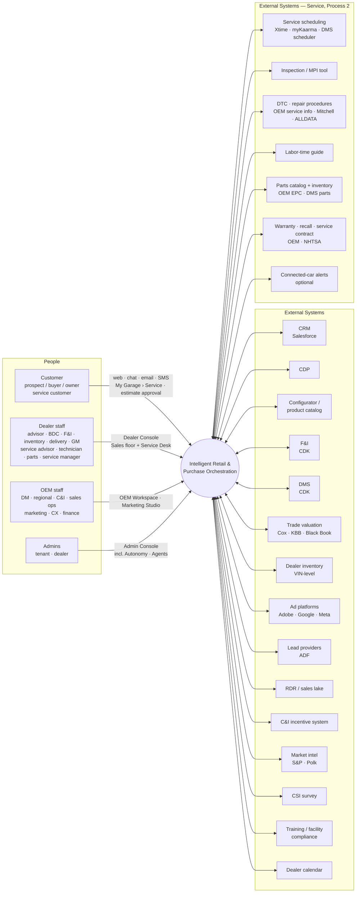

The DMS appears in both processes: deal desk and delivery for Process 1; repair order, invoice, and service history for Process 2. It stays system of record for the RO; Retail Ops mirrors it and owns the *service journey* around it.

---

## 2. Logical Layers

The layered view. Every arrow crosses a layer boundary through a defined contract (REST, A2A, Gateway tool, EventBridge event, or Connector interface).

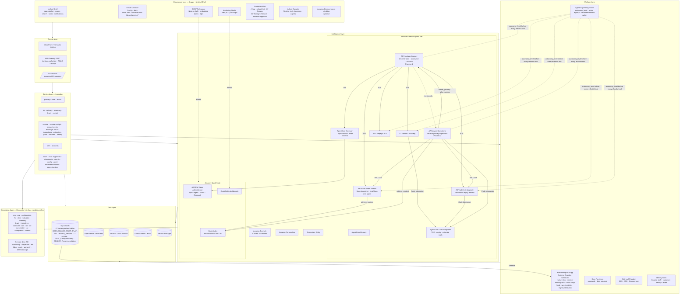

**Two supervisors.** A2 owns the purchase journey and calls A1/A3/A4/A5 as specialists. A7 owns the service journey and calls A4 (equity), A3 (talk tracks, upsell brief), and A2 (`create_journey`, `plan_nurture`) as tools. A2 never drives A7; the only A2 → A7 path is the `vehicle.delivered` event. Both call the same `autonomy_level(action_id, scope)` check before any effectful tool (§4.10.1).

---

## 3. Runtime Component View

How a request actually travels. Four entry paths: dealer console, OEM workspace (Quick embed), customer web, and scheduled/automated.

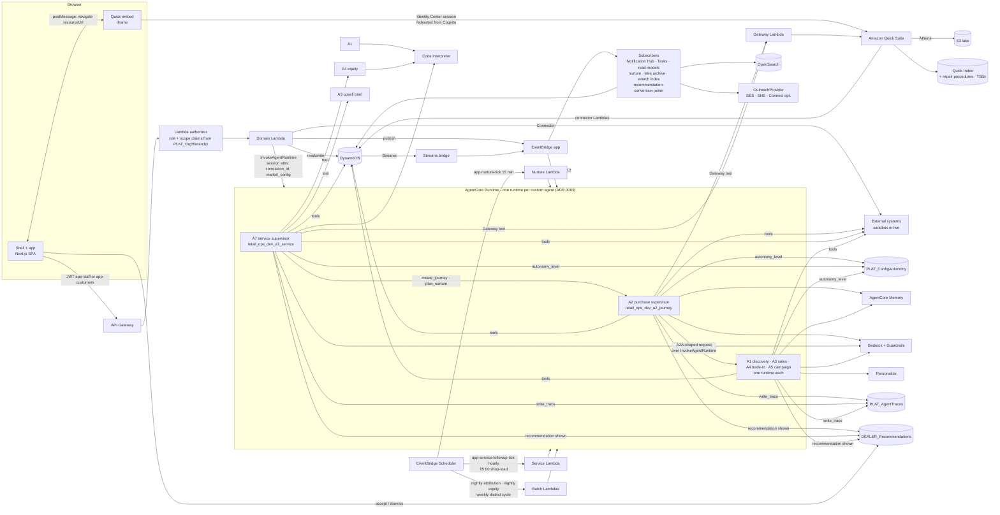

Text fallback: the browser shell calls API Gateway; the authorizer adds role and scope claims; the domain Lambda reads and writes DynamoDB, publishes to EventBridge, calls connectors, and calls agents with `InvokeAgentRuntime`. Each custom agent runs in its own AgentCore runtime: the A2 purchase supervisor (`retail_ops_dev_a2_journey`), the A7 service supervisor (`retail_ops_dev_a7_service`), and A1, A3, A4 and A5's recommendation step (`retail_ops_dev_a1_discovery`, `retail_ops_dev_a3_sales`, `retail_ops_dev_a4_trade_in`, `retail_ops_dev_a5_campaign`). A2 reaches A1, A3 and A4 with an A2A-shaped request carried by `InvokeAgentRuntime`; A2 and A7 meet through events; both reach Quick through the Gateway Lambda. The agents read autonomy levels, call tools against DynamoDB and external systems, use Bedrock with Guardrails, and write traces and recommendations. Quick reads the lake, DynamoDB connectors and Quick Index. Subscribers, the nurture and service Lambdas and the batch Lambdas trigger the runtimes from events and schedules.

Five entry paths, not four: dealer console, OEM workspace (Quick embed), customer web (incl. estimate approval by magic link), **event-triggered** (any §4.10.2 subscription), and **scheduled** (nurture tick, service follow-up tick, 05:00 shop-load, nightly equity and attribution, weekly district cycle). The last two are what make the system agentic rather than request-driven.

---

## 4. End-to-End Journey Flow (business process)

The canonical path from first touch to ownership, showing which persona, screen, agent, and event owns each step. This is the "one owner of the funnel" story.

```mermaid
flowchart LR
  classDef stage fill:#6366f1,stroke:#4f46e5,color:#fff
  classDef cust fill:#0ea5e9,color:#fff,stroke:#0284c7
  classDef dlr fill:#10b981,color:#fff,stroke:#059669
  classDef agt fill:#8b5cf6,color:#fff,stroke:#7c3aed
  classDef evt fill:#f59e0b,color:#000,stroke:#d97706

  S1[DISCOVER]:::stage --> S2[CONFIGURE]:::stage --> S3[QUALIFY]:::stage --> S4[FINANCE]:::stage --> S5[TRADE_IN]:::stage --> S6[AGREE]:::stage --> S7[DELIVER]:::stage --> S8[OWN]:::stage

  subgraph d1[ ]
    C1[Customer: ad click / web /<br/>lead form / service lane]:::cust
    A1a[A1 lifestyle intake +<br/>shortlist · Personalize]:::agt
    B1[BDC: Lead Desk<br/>first response · SLA]:::dlr
    E1{{lead.received<br/>journey.created}}:::evt
  end
  subgraph d2[ ]
    C2[Customer: /shop build<br/>saved to My Garage]:::cust
    A1b[A1 trim + packages<br/>price_build · VIN match]:::agt
    E2{{build.saved}}:::evt
  end
  subgraph d3[ ]
    C3[Customer: test drive<br/>booked via A2 nudge]:::cust
    D3[Advisor: Live Advisor<br/>Customer 360 · objections]:::dlr
    A3a[A3 floor path +<br/>Quick Index grounding]:::agt
    E3{{appointment.booked<br/>handoff BDC→advisor}}:::evt
  end
  subgraph d4[ ]
    C4[Customer: prequal link<br/>in My Garage]:::cust
    F4[F&I: F&I Desk<br/>offers · menu]:::dlr
    A3b[A3 structure_deal]:::agt
    E4{{prequal.decided}}:::evt
  end
  subgraph d5[ ]
    C5[Customer: trade offer<br/>photos · mileage]:::cust
    I5[Inventory mgr:<br/>disposition]:::dlr
    A4a[A4 valuation ·<br/>equity · payment delta]:::agt
    E5{{trade.valued<br/>trade.accepted}}:::evt
  end
  subgraph d6[ ]
    F6[F&I: push_deal_to_dms<br/>documents shared]:::dlr
    E6{{deal.booked}}:::evt
  end
  subgraph d7[ ]
    L7[Delivery coord:<br/>Delivery Board]:::dlr
    A2a[A2 delivery messages<br/>survey]:::agt
    E7{{vehicle.delivered}}:::evt
  end
  subgraph d8[ ]
    C8[Customer: My Garage<br/>ownership + Service]:::cust
    V8[A7 creates DEALER_Vehicles row<br/>+ first-service reminder]:::agt
    A4b[A4 monitor_equity nightly<br/>equity.crossed_positive]:::agt
    E8{{vehicle.delivered<br/>→ service journeys begin}}:::evt
  end

  S1 --- d1
  S2 --- d2
  S3 --- d3
  S4 --- d4
  S5 --- d5
  S6 --- d6
  S7 --- d7
  S8 --- d8
  E8 -.->|new journey · previous_journey_id<br/>source=service_lane · upgrade| S1

  A2X[A2 Purchase Journey Orchestration<br/>owns state · validate_handoff · nurture · Sales Package<br/>select_next_best_action · run_play on triggers]:::agt
  A2X -.-> S1 & S2 & S3 & S4 & S5 & S6 & S7 & S8
```

Rules enforced along the way:

- No stage advances without a `journey.stage_changed` event carrying `actor` and `evidence`.
- A2 `validate_handoff` blocks a transition when the stage's required context is missing (§2.1) and surfaces the gap in Customer 360. AGREE additionally requires the credit-compliance gate (OFAC, Red Flags, adverse action) from the F&I connector.
- Each person-to-person handoff creates an `DEALER_Handoffs` row and a Task for the receiver.
- A2 nurture runs in parallel across all stages until a stop condition (deal booked, opt-out, human handoff, 45 days cold).
- **OWN is a resting state** (§2.1). A repeat purchase, a lease-end upgrade, or an A7 **repurchase/upgrade handoff** creates a *new* journey in DISCOVER with `previous_journey_id`; the OWN journey is marked `superseded_by`. The single-active rule applies only to DISCOVER–DELIVER.

### 4a. Service Journey Flow (Process 2, spec §2.1.1)

Runs for the life of the VIN; at most one active per VIN; owned by A7. Each visit is its own `DEALER_ServiceJourneys` record.

```mermaid
flowchart LR
  classDef stage fill:#0f766e,stroke:#115e59,color:#fff
  classDef cust fill:#0ea5e9,color:#fff,stroke:#0284c7
  classDef dlr fill:#10b981,color:#fff,stroke:#059669
  classDef agt fill:#8b5cf6,color:#fff,stroke:#7c3aed
  classDef evt fill:#f59e0b,color:#000,stroke:#d97706

  T1[BOOK]:::stage --> T2[CHECK_IN]:::stage --> T3[INSPECT]:::stage --> T4[DIAGNOSE]:::stage --> T5[APPROVE]:::stage --> T6[REPAIR]:::stage --> T7[READY]:::stage --> T8[FOLLOW_UP]:::stage

  subgraph s1[ ]
    C1[Customer: My Garage › Service<br/>or A7 proactive: recall · telematics · due]:::cust
    A1s[A7 book_service · predict_next_service<br/>loaner / mobile capacity]:::agt
    M1[05:00 morning work: dispatch_ro<br/>stage_parts · prepare_ro_brief]:::agt
    E1{{service.journey.created<br/>service.appointment.booked}}:::evt
  end
  subgraph s2[ ]
    D2[Service advisor: Check-in tablet<br/>mileage · concerns · photos · dictation]:::dlr
    A2s[A7 open_repair_order<br/>DMS RO mirrored]:::agt
    E2{{ro.opened → A4 monitor_equity}}:::evt
  end
  subgraph s3[ ]
    D3[Technician: MPI tablet<br/>green / yellow / red + evidence]:::dlr
    A3s[A7 record_inspection<br/>prioritize_findings]:::agt
    E3{{inspection.submitted}}:::evt
  end
  subgraph s4[ ]
    D4[Technician: DTCs · cause]:::dlr
    A4s[A7 lookup_dtc · get_repair_procedure<br/>get_labor_time · lookup_parts · check_coverage<br/>build_estimate in Code Interpreter]:::agt
  end
  subgraph s5[ ]
    C5[Customer: line-by-line approval<br/>My Garage / SMS magic link]:::cust
    D5[Advisor: Estimate & Approval<br/>customer-facing mode · objection]:::dlr
    A5s[A7 present_estimate · explain_finding<br/>auto_present under threshold · record_approval]:::agt
    E5{{estimate.presented<br/>estimate.line_decided<br/>service.declined_work.recorded}}:::evt
  end
  subgraph s6[ ]
    D6[Shop + Parts desk:<br/>lines · orders · back-orders]:::dlr
    A6s[A7 track_parts · update_line_status<br/>reforecast_promise · re-dispatch]:::agt
    E6{{parts.* · ro.line_completed}}:::evt
  end
  subgraph s7[ ]
    D7[Advisor: Notify ready<br/>invoice shared · pickup slot]:::dlr
    A7s[A7 notify_ready · DMS close_ro]:::agt
    E7{{ro.closed · vehicle.ready}}:::evt
  end
  subgraph s8[ ]
    A8s[A7 → A2 plan_nurture service templates<br/>A7 → A4 compute_equity<br/>A7 handoff_to_sales when triggered]:::agt
    E8{{service.visit.completed<br/>service.equity_flag<br/>service.handoff_to_sales}}:::evt
  end

  T1 --- s1
  T2 --- s2
  T3 --- s3
  T4 --- s4
  T5 --- s5
  T6 --- s6
  T7 --- s7
  T8 --- s8
  E8 -.->|A2 create_journey source=service_lane<br/>new purchase journey in DISCOVER| PJ[Process 1 · DISCOVER]

  A7X[A7 Service Operations<br/>owns state · validate_service_handoff · morning work · promise re-forecast]:::agt
  A7X -.-> T1 & T2 & T3 & T4 & T5 & T6 & T7 & T8
```

Rules enforced along the way (mirror of Process 1):

- No stage advances without a `service.stage_changed` event in `DEALER_ServiceJourneyEvents`.
- `validate_service_handoff` blocks APPROVE unless every estimate line has a labor op, price `source_ref`, and coverage check; REPAIR unless every line has a customer decision; READY unless the RO is closed in the DMS and the invoice document exists.
- Every yellow/red inspection item requires evidence; every recommendation traces to an inspection item, DTC, recall, or maintenance-schedule row.
- Approval decisions belong to the customer. `auto_present_estimate` presents; it never approves.
- Technician masking is server-side on the RO endpoint (no customer contact data, no margins).
- Where the two processes meet (the vehicle lifecycle loop): **first lap** `vehicle.delivered` → A7 creates the `DEALER_Vehicles` row and the first-service reminder (sale → first service); **later laps** the **repurchase/upgrade handoff** — `service.handoff_to_sales` / `equity.crossed_positive` / `lease.end_window_entered` → A2 creates a new purchase journey or runs the *Upgrade Pitch* play (service → next sale); declined work → A2 *service* templates only.

---

## 5. Agent Orchestration Flow (Sales Package request)

What happens when an advisor opens a customer in the Live Advisor. Shows the supervisor fan-out, the AgentCore ↔ Quick bridge, and streaming updates.

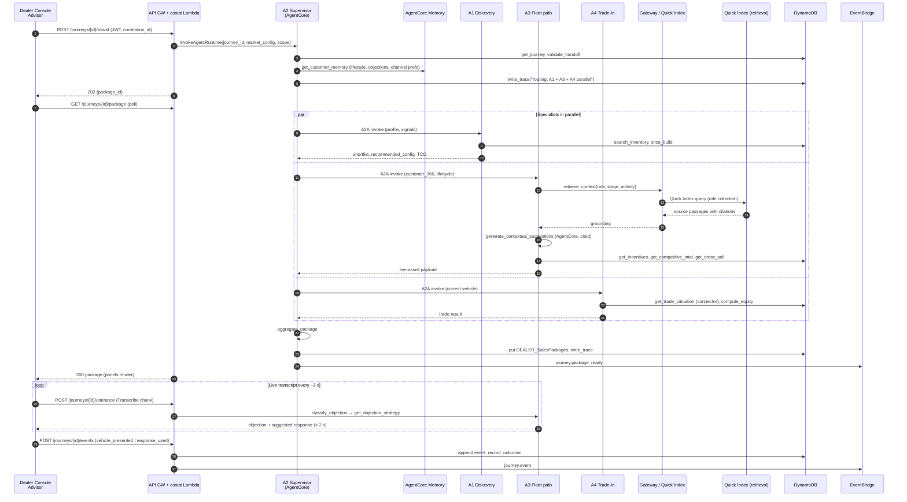

---

## 6. A2 Nurture Loop (long-running, agentic)

The asynchronous half of A2. Runs on a scheduler and on inbound events; independent of any screen being open.

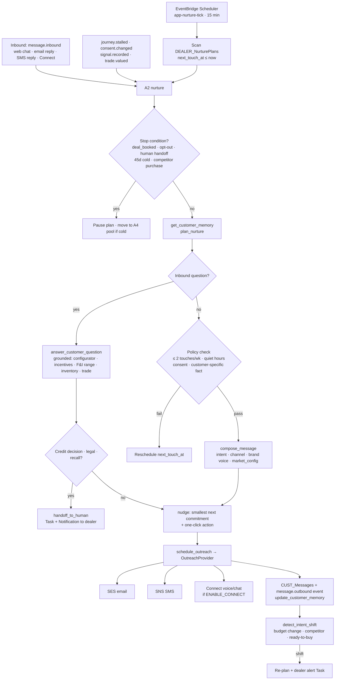

---

## 6a. A7 Morning Work and Promise Re-forecast (long-running, agentic)

A7 is long-running because state is persisted and work resumes from schedules
and events—not because one invocation stays open. No advisor click initiates
these paths: the shift-start caller is EventBridge Scheduler and the intraday
caller is a catalogued EventBridge event (acceptance criterion 32). The schedule
must resolve **5:00 AM in each dealer's configured time zone** and carry a stable
`trigger_id`, so retries are idempotent and daylight-saving changes do not move
the run relative to the shift.

```mermaid
sequenceDiagram
  autonumber
  participant SCH as EventBridge Scheduler<br/>5 am dealer time
  participant BUS as EventBridge event bus
  participant A7 as A7 Service supervisor
  participant AUT as Autonomy policy<br/>level and constraints
  participant DB as DynamoDB<br/>journeys, roster, recommendations
  participant CON as Connector layer<br/>DMS, scheduling, parts, warranty
  participant CI as AgentCore Code Interpreter
  participant HUB as Tasks, approvals, notifications
  participant OUT as OutreachProvider<br/>consent checked

  rect rgb(240, 248, 255)
    Note over SCH,HUB: Shift-start planning
    SCH->>A7: shop-load(dealer_id, service_date, trigger_id)
    A7->>DB: BOOK visits due today, roster, skills, capacity, open recommendations
    loop each booked service journey
      A7->>A7: prepare_ro_brief(service_journey_id)
      par Gather service context
        A7->>DB: history, declined work, recalls, equity snapshot
      and Ground operational inputs
        A7->>CON: predict_next_service, check_coverage, lookup_parts
      end
      CON-->>A7: sourced due items, coverage, on-hand, ETA
      A7->>A7: filter qualified technicians; HV certification is a hard gate
      A7->>A7: build dispatch and parts-staging proposals
      Note over A7,AUT: Missing parts qualify only when on-hand is zero,<br/>confidence is at least 0.8, and daily spend remains under cap
      A7->>CI: build estimate draft from known, sourced lines
      CI-->>A7: inputs, code, result, source references
      A7->>DB: persist advisor brief and estimate draft for the Service Board

      loop each proposed effect: dispatch, stage parts, present estimate
        A7->>AUT: resolve(action_id, dealer, constraints)
        AUT-->>A7: level plus amount, channel, consent, and daily-cap constraints
        alt observe
          A7->>DB: trace proposal only; no visible action
        else recommend
          A7->>DB: write DEALER_Recommendations card with level and evidence
          A7->>HUB: route card to advisor, foreman, or parts counter
        else act_with_approval
          A7->>DB: write prepared recommendation with exact payload
          A7->>HUB: create one-tap approval task
        else act_and_notify
          A7->>CON: execute permitted assignment or parts action idempotently
          opt estimate presentation is permitted by policy
            A7->>OUT: send magic link; customer still decides every line
          end
          A7->>DB: record execution, level, evidence, and outcome link
          A7->>HUB: notify affected staff and expose undo where supported
        end
      end
    end
    A7->>HUB: publish Service Board readiness summary before first login
  end

  rect rgb(255, 248, 240)
    Note over BUS,OUT: Intraday recovery from operational events
    CON-->>BUS: parts.backordered, parts.received, ro.line_completed, technician unavailable
    BUS->>A7: event_id, service_journey_id, correlation_id
    A7->>DB: load current RO, line status, technician load, promised and projected times
    A7->>A7: recompute dispatch and projected-ready time
    opt backorder or technician unavailable
      A7->>AUT: resolve(a7.dispatch_ro, dealer, constraints)
      A7->>HUB: recommend, request approval, or notify after re-dispatch
    end
    A7->>AUT: resolve(a7.reforecast_promise, dealer, consent constraints)
    alt projected ready is later than promised
      A7->>DB: record new projection and sourced reason
      alt level permits execution and channel has consent
        A7->>OUT: send new time and reason before original promise passes
        A7->>HUB: flag advisor and record notification
      else recommendation or approval required
        A7->>DB: write promise-update recommendation with level
        A7->>HUB: route urgent advisor task
      end
    else projection improves or is unchanged
      A7->>DB: update Service Board projection only
    end
  end
```

**Control and measurement.** Every visible recommendation, approval, or executed
action is recorded with the resolved autonomy level, source evidence,
`trigger_id`/`event_id`, and outcome link. `observe` produces only a trace. The
customer-owns-approval rule is never configurable: `auto_present_estimate` may
present an eligible estimate but cannot approve a line. Stores begin with every
action at `recommend` during the 14-day observation period; Admin › Agents shows
acceptance, overrides, promise changes, and outcomes before autonomy is raised.
The shift-start KPI is "advisor morning work done before shift start" (spec
§1.3).

**As-built boundary.** The reference implementation currently runs `shop-load`
at 10:00 UTC and sweeps BOOK-stage visits for `dispatch_ro`, `stage_parts`, and
`reforecast_promise` recommendations. The named tools for briefs, estimate
presentation, Code Interpreter calculation, and secure outreach exist, but
per-dealer time-zone scheduling, event-triggered re-dispatch/reforecast,
constraint-aware parts-order execution, and the full autonomy outcome ladder in
this diagram remain target behavior. `docs/ACCEPTANCE.md` is the current status
source.

---

## 7. A6 OEM Workspace Flow (Quick-hosted)

How a District Manager's action moves through the Quick stack, the guardrail policy, and back into the Dealer Console.

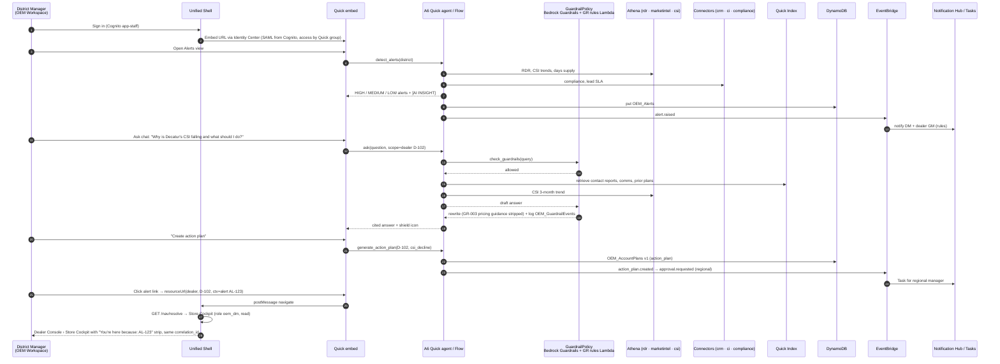

---

## 8. Event Backbone Flow

How state changes propagate across apps and stacks without point-to-point coupling.

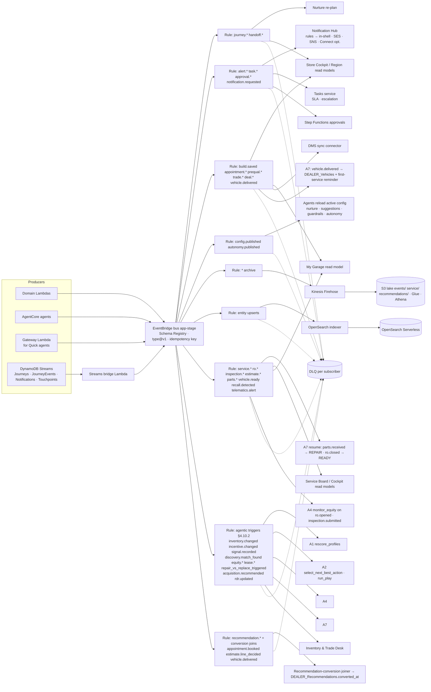

Rules R7–R9 are new in v1.2. R8 is the agentic backbone: it is how agents act without a user request. R9 closes the outcome loop so agents can learn.

---

## 9. Identity, Authorization, and Cross-App Navigation

One login, one scope model, one URL contract across three stacks.

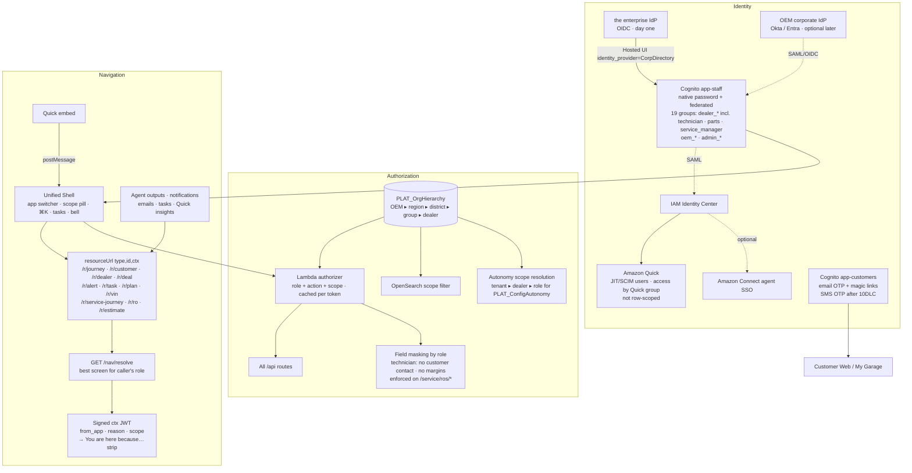

---

## 10. Data Flow

Where data enters, where it lives, what may move where (classification C1–C4), and how it reaches analytics and models.

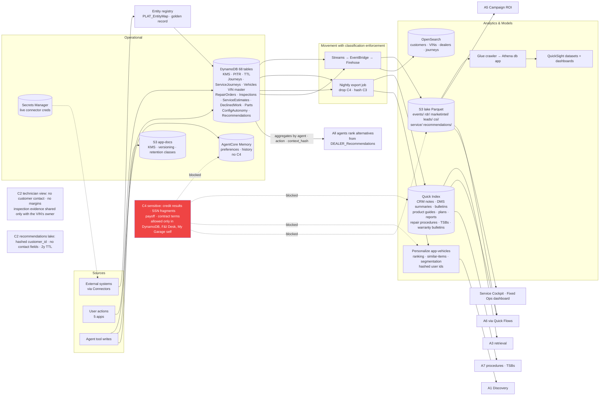

---

## 11. Deployment Topology

Single account per environment (`dev`, `demo`, `prod`), region `us-east-1`, provisioned by `deploy/deploy.sh` stages.

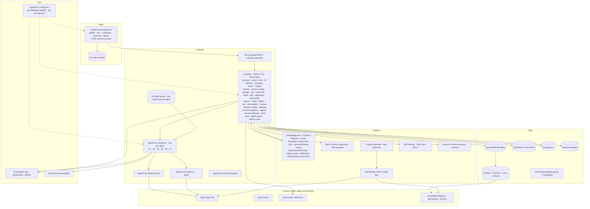

Text fallback for the compute tier: API Gateway fronts the domain Lambdas; the Lambdas call six AgentCore runtimes, one per custom agent (A1, A2, A3, A4, A5's recommendation step, A7), each deployed from its own Linux arm64 zip in the S3 code bucket (direct code deployment, ADR 0007, ADR 0009); the runtimes reach AgentCore Memory and the Gateway to the Quick-hosted A6 agent, and log to CloudWatch and AgentCore observability.

The diagram shows the target topology. A deployment does not provision the customer pool `app-customers`, IAM Identity Center, the Schema Registry, DynamoDB Streams, OpenSearch Serverless, the `app-docs` bucket, an SES identity or SNS topic, Amazon Connect, Amazon Personalize or AgentCore Memory; the code falls back to a local implementation where one of them is absent. The deployed tables number 68.

**Deploy stages → resources** (`deploy/deploy.sh`, in order; the full table is in [`docs/external/04-deployment.md`](../external/04-deployment.md#the-ordered-stages))

| Stage | Creates / updates |
|---|---|
| `cognito` | Staff user pool `retail-ops-<env>-staff` with 19 role groups and development seed users, the web app client, the hosted-UI domain and client for federation (`RETAIL_OPS_ENABLE_SSO=1`), and the client-credentials client for the Quick MCP connector |
| `data` | The 68 DynamoDB tables, loaded from the synthetic packs (`--markets us` or `us,de` on `bootstrap.sh`) |
| `sso-admins` | Administrator user records for the allowlisted identities |
| `events` | Event bus `app-bus-<env>`, subscriber Lambda, rule and dead-letter queue |
| `lake` | Lake bucket, Firehose stream and rule, Glue database with 13 tables, Athena workgroup, analytics mirrors and roll-ups |
| `corpus` | The 538-document knowledge corpus exported to the lake bucket |
| `guardrails` | The main Bedrock Guardrail and the store digest's copy |
| `kb` | S3 Vectors bucket and index, the Bedrock Knowledge Base and its first ingestion |
| `l4` | Per-function IAM roles, the authorizer and service Lambdas, and the REST API |
| `approvals` | The plan-approval Step Functions state machine and its submit Lambda |
| `l6` | Job Lambdas, the scheduler role and the EventBridge Scheduler schedules |
| `demo-reset` | The dev-only demo-reset Lambda |
| `alarms` | Errors and throttles alarms for every Lambda, and an unknown-outcome alarm per agent-owned job |
| `agentcore` | Direct code deployment (ADR 0007): one Linux arm64 zip per agent → S3 → one AgentCore runtime per agent (ADR 0009), the Journey Agent last; then re-runs `l4` and `l6` |
| `gateway` | The OEM read Lambda, the IAM-authenticated Gateway for the console and the JWT-authenticated Gateway for Amazon Quick |
| `quick` (optional) | Quick sharing groups, the Athena data source and lake datasets, then the Quick content (`docs/QUICK_BUILD.md`) |
| `console` | The static console build, its S3 bucket, CloudFront distribution, origin access control and URL-rewrite function |
| `waf` | The AWS WAF web ACL on the distribution |

---

## 12. Cross-Stack Continuity Example (acceptance criterion 18)

One user path through all three stacks, to make the connective tissue concrete.

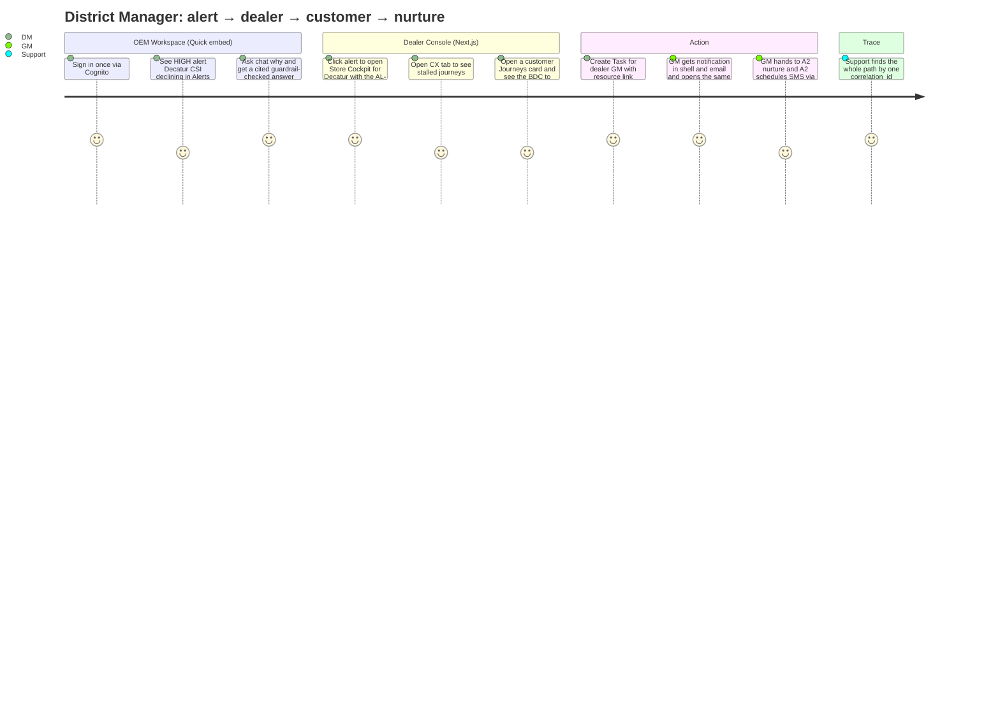

### 12a. Repurchase/Upgrade Handoff Continuity Example (acceptance criteria 29, 35, 37)

The service-to-next-sale path (a later lap of the vehicle lifecycle: sale → ownership/service → next sale), with no user action until the advisor accepts.

```mermaid
flowchart TB
  classDef phase fill:#0b1f3a,color:#fff,stroke:#0b1f3a
  classDef a7 fill:#0f766e,color:#fff,stroke:#0f766e
  classDef other fill:#e6e9ef,color:#1f2937,stroke:#8a94a6

  P1[Before the visit — no user action]:::phase
  B1[A7 books from a recall.detected event and confirms by SMS]:::a7
  B2["At 5 am A7 dispatches the RO to an HV-certified technician and stages the recall part"]:::a7
  B3[A7 prepares the advisor brief with declined work and coverage]:::a7
  P1 --> B1 --> B2 --> B3

  P2[Service Desk]:::phase
  S1[Advisor checks in on the tablet — RO mirrored from DMS, ro.opened emitted]:::other
  S2[A4 monitor_equity picks up fresh mileage, equity crosses positive]:::a7
  S3[Technician submits MPI — red brake finding with photo evidence]:::other
  S4["A7 builds the estimate in Code Interpreter; brake line exceeds 50 percent of the A4 valuation"]:::a7
  B3 --> P2 --> S1 --> S2 --> S3 --> S4

  P3[Customer]:::phase
  C1[Estimate arrives by magic link within 60 seconds — customer approves the recall line, declines brakes]:::other
  C2[Declined brakes recorded with evidence, A2 schedules a service-template reminder]:::a7
  S4 --> P3 --> C1 --> C2

  P4[Repurchase/upgrade handoff]:::phase
  H1[repair_vs_replace_triggered emitted — A7 handoff_to_sales creates a purchase journey in DISCOVER with previous_journey_id]:::a7
  H2[A2 runs the Upgrade Pitch play at the dealer autonomy level, advisor sees the card in Service Lane]:::a7
  H3[Advisor accepts — DEALER_Recommendations row converts when the test drive books]:::other
  C2 --> P4 --> H1 --> H2 --> H3

  H3 --> T[One correlation_id spans the recall event, RO, estimate, equity flag, new journey, and play]:::phase
```

---

## 13. Agentic Operating Model (spec §4.10)

How a proactive agent action is gated, executed, and learned from. Applies identically to all seven agents.

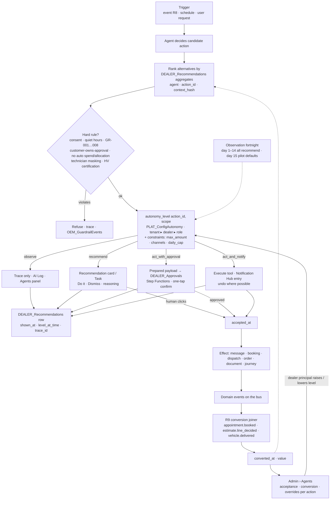

Three properties fall out of this diagram. First, autonomy is a *runtime* decision per action and scope, so the same code serves a store that wants everything as suggestions and a store that wants the morning work done. Second, hard rules sit *before* the autonomy check, so no configuration can raise them. Third, every path writes the same recommendations row, so learning does not depend on which level was in force.

---

## 14. Reading Guide

| If you want to… | Read |
|---|---|
| Understand who uses what | §1 System Context, spec §5.2 |
| See how the stacks fit and the two supervisors | §2 Logical Layers, §3 Runtime, spec §2.2.1, §3.7 |
| Follow a customer through the purchase funnel | §4 Journey Flow, spec §2.1 |
| Follow a vehicle through a service visit | §4a Service Journey Flow, spec §2.1.1, §5.20 |
| Understand agent fan-out and the AgentCore ↔ Quick bridge | §5, §7, spec §2.2.1, §4.3.1 |
| Understand the nurture agent | §6, spec §3.2 |
| Understand A7's morning work and promise re-forecast | §6a, spec §3.7, §4.10.2 |
| Understand how agents act without being asked, and how a dealer controls that | §13, §8 rules R8–R9, spec §4.10 |
| Wire an integration or a new screen | §8 Events, spec §4.1, §4.6, §5.18 |
| Do security review | §9, §10, spec §8, §5.20.5 masking |
| Deploy | §11, spec §7 |
| See both processes connect end to end | §12, §12a, acceptance criteria 18, 29, 35, 37 |
