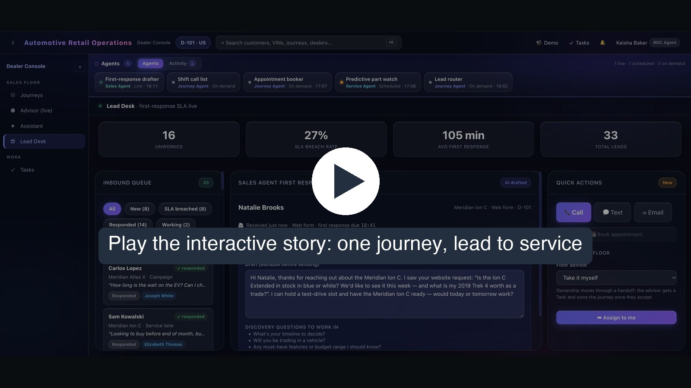
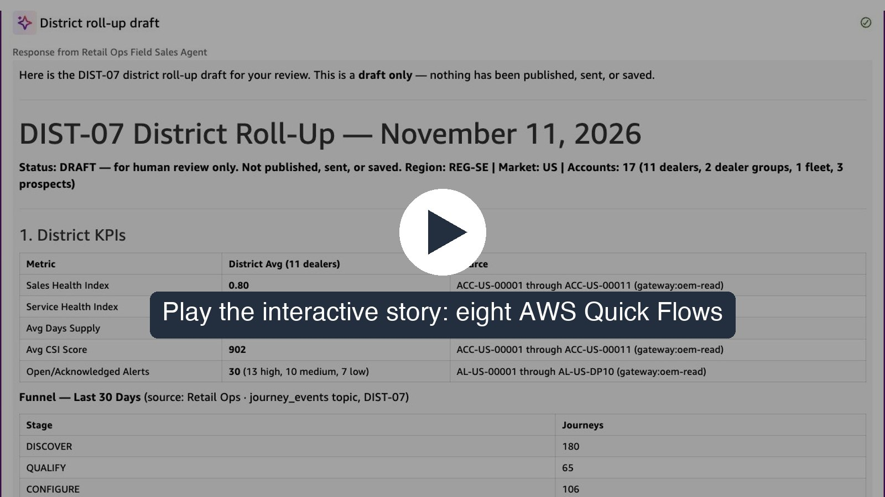

# One journey, lead to service: the use case and how it is built

*Guidance for Automotive Retail Operations using Agentic AI on AWS*

This page puts the business story and the architecture side by side. Each part
opens with a short interactive story of the people and agents at work, followed
by the architecture diagrams that implement it. Select a diagram to open it full
size. Deployment steps and cost are in the [README](../README.md).

> **About the interactive stories.** GitHub shows HTML files as source code, so
> each story below is a still frame that links to the story file. To play it,
> download the file (or clone the repository) and open it in a browser; the
> play control at the bottom plays, pauses and scrubs. The stories need no
> internet connection. If GitHub Pages is enabled for this repository, the
> stories also play straight from the Pages site.

**On this page:** [The problem](#the-problem-every-handoff-loses-the-customer) ·
[Part 1: Dealer journey](#part-1-agents-for-your-team-and-your-customer) ·
[Part 2: OEM field sales](#part-2-sales-operations-simplified-with-aws-quick-flows) ·
[The seven agents](#the-seven-agents) ·
[What gets deployed](#what-gets-deployed-and-what-it-costs)

## The problem: every handoff loses the customer

A vehicle purchase and its service visits cross many systems that each optimize
their own step: the CRM owns the lead, the dealer management system (DMS) owns
the deal and the repair order, valuation tools own the trade-in, marketing
platforms own the campaign, and scheduling and inspection tools own the service
visit. None of them sees the whole customer, so context is lost at each handoff,
and people re-key, look up and chase information by hand while the buyer waits.

| One shared journey record | Agents that do the legwork | People stay in control |
|---|---|---|
| Sales and service run as two state machines, DISCOVER → OWN and BOOK → FOLLOW-UP, that share one customer record and talk only through events and recorded handoffs. | Seven agents draft first responses, prepare trade-in and finance options, build estimates and turn service-lane equity into the next sale. Every figure comes from a deterministic service, with its source. | Agents start at *recommend*: they write cards, leads and drafts for a person to approve. Amazon Bedrock Guardrails check every model call. |

## Part 1: Agents for your team and your customer

**One journey, lead to service.** Follow one buyer from an online lead through
sale, finance, delivery and the first service visit, and see which agent helps
each role at each handoff.

[Open the story: one journey, lead to service](../assets/story-01-agents-one-journey-lead-to-service.html)
(HTML, about 12 MB; download and open in a browser)

### How it is built

#### End-to-end overview

The sales journey and the service journey run as two independent state machines.
The Purchase Journey supervisor advances DISCOVER → OWN; the Service Journey
supervisor runs BOOK → FOLLOW-UP. They share no synchronous call path: delivery
(DELIVER → OWN) emits an event that opens service eligibility, and an equity
signal in the service lane becomes a recorded handoff that opens a new sales
journey.

#### Sales flow: lead to delivery

1. Every request takes the same path: Amazon CloudFront, Amazon Cognito, Amazon
   API Gateway, AWS Lambda and Amazon DynamoDB, with no model call on page load.
2. An inbound lead gets a drafted first response from the Sales Agent on Amazon
   Bedrock.
3. On the sales floor, the advisor sees ranked vehicle matches, objection
   handling and the next best action.
4. Trade-in equity, payments and total cost of ownership are calculated in
   AgentCore Code Interpreter, so every number is auditable.
5. A stage gate checks each handoff; Step Functions routes approvals above the
   autonomy ceiling.
6. Delivery moves the journey to OWN, which My Garage reads.
7. Every tool call lands in the agent-trace table and the event lake.

#### Service flow: booking to follow-up

1. My Garage books against due maintenance, open recalls and prior declines; a
   Lambda function computes bay capacity and the promised time.
2. At check-in and inspection, the Service Agent writes the repair-order brief
   and joins trouble codes to cited service bulletins.
3. The estimate is priced in Code Interpreter; every line carries its source.
4. The customer approves line items on a phone; decisions and declines are
   stored.
5. A parts-received event moves the repair order to REPAIR and re-forecasts the
   promise.
6. Scheduled jobs drive approval chasing and 30/60/90-day follow-up.

#### Service to sales handoff: the next purchase

A nightly job computes vehicle equity, and the service-lane monitor flags
positive equity, high mileage and lease-end on today's repair orders. The Sales
Agent writes an upsell brief grounded on the inspection and declined work. The
handoff is recorded and published as an event, and the Journey Agent opens a new
DISCOVER journey. One correlation ID lets the event lake attribute the eventual
delivery back to the service visit.

> **In the story:** the first response, trade-in and finance desks map to the
> sales flow; the booking, inspection, estimate and approval scenes map to the
> service flow; the "upgrade signal" in the service lane is the handoff.

## Part 2: Sales operations, simplified with AWS Quick Flows

**One input in, a finished draft out.** Eight Flows give the OEM district
manager and sales operations a cited draft from live, scoped dealer data:
District Roll-up, Sales Ops Digest, Account Plan, Opportunity Brief, Meeting
Package, Win Strategy, Contact Report and Action Plan.

[Open the story: eight AWS Quick Flows](../assets/story-02-sales-operations-quick-flows.html)
(HTML, about 27 MB; download and open in a browser)

### How it is built

#### OEM field sales in AWS Quick

1. District managers, regional leads, planners, marketing and finance sign in to
   AWS Quick, or open the OEM Workspace from the console.
2. One shared Quick space holds the Field Sales chat agent, the eight Flows, the
   Journey Funnel topic, the Campaign ROI & Funnel dashboard and nine knowledge
   bases.
3. An MCP connector gets a token from Amazon Cognito, with its client secret in
   AWS Secrets Manager.
4. The AgentCore Gateway checks the token and calls a Lambda function that
   derives the OEM scope and returns cited rows through four read-only tools.
5. Amazon Data Firehose streams every journey and service event to the S3 lake;
   AWS Glue catalogs it and Amazon Athena queries it.
6. The knowledge corpus (538 documents, contact details masked) feeds the
   knowledge bases.
7. Every Flow ends in a cited draft that a person reviews before it is sent,
   checked against OEM policy rules GR-001 to GR-008.

#### Marketing analytics: spend to delivered vehicles

Journey and service events land in the S3 event lake. A nightly attribution job
joins marketing spend to delivered vehicles in Amazon Athena, and the Campaign
Agent drafts a budget shift with a source for each figure. Step Functions routes
the plan to finance for approval, the approved policy is published as versioned
configuration, and a scheduled nurture job executes it.

> **In the story:** each Flow's "Where the data comes from" panel is the path in
> the field sales diagram, from the input through the OEM Read Gateway and the
> funnel topic to the cited draft.

## The seven agents

The console and AWS Quick show agents by name only. Each agent is named for its
job and serves one or both processes, or the OEM level above them.

| Agent | What it does | Where it works |
|---|---|---|
| **Journey Agent** | Supervises the purchase journey, DISCOVER → OWN; validates each stage handoff and builds the Sales Package | Sales process |
| **Discovery Agent** | Lifestyle intake and ranked vehicle matches, EV and ICE | Sales process |
| **Sales Agent** | First responses, live floor assistance and objection handling; upsell briefs from the service lane | Sales process |
| **Trade-In Agent** | Trade-in value, payoff and equity, with comparables | Sales process |
| **Service Agent** | Supervises the service journey, BOOK → FOLLOW-UP; repair-order briefs, estimates and follow-up | Service and ownership |
| **Campaign Agent** | Campaign attribution and budget-shift recommendations | OEM marketing |
| **Field Sales Agent** | Chat and the eight Flows for district managers and sales operations | OEM field sales, in AWS Quick |

## What gets deployed, and what it costs

The one-click deployment (`deploy/guidance-deploy.sh`) runs unattended in a
fresh account, verifies itself and prints the console URL. It needs no Docker,
CDK, CloudFormation or third-party key. AWS Quick is an optional add-on.

| 6 | 68 | 17 | 2 |
|:---:|:---:|:---:|:---:|
| agent runtimes on Amazon Bedrock AgentCore | on-demand Amazon DynamoDB tables | AWS Lambda functions for the API, events and scheduled agent jobs | Amazon Bedrock Guardrails on every model call |

| Scenario (fictional OEMs from the synthetic data) | Per month | Per dealer |
|---|---:|---:|
| Pilot: Meridian Motors (US), 11 dealers, 72 users | $693.14 | $63.01 |
| Regional rollout: Meridian Motors (US) + Nordwerk Automobile (DE), 100 dealers, 1,000 users | $6,121.38 | $61.21 |

US East (N. Virginia), on-demand list prices, for the resources a default
deployment creates; Amazon Bedrock model usage is most of it. The assumptions and
unit prices are in the editable
[cost estimate workbook](cost/cost-estimate.xlsx). Prices change; check the AWS
Pricing Calculator before you rely on them.

**Next:** [Deploy the Guidance](../README.md#deploy-the-guidance) ·
[Documentation for customers and partners](external/README.md) ·
[Step-by-step demo workflows](DEMO_WORKFLOWS.md)

---

The data shown is synthetic: fictional brands and dealers, no real customer
records.

*Customers are responsible for making their own independent assessment of the
information in this Guidance. This Guidance: (a) is for informational purposes
only, (b) represents AWS current product offerings and practices, which are
subject to change without notice, and (c) does not create any commitments or
assurances from AWS and its affiliates, suppliers or licensors. AWS products or
services are provided “as is” without warranties, representations, or conditions
of any kind, whether express or implied. AWS responsibilities and liabilities to
its customers are controlled by AWS agreements, and this Guidance is not part of,
nor does it modify, any agreement between AWS and its customers.*

© 2026 Amazon Web Services, Inc. or its affiliates. All rights reserved.
